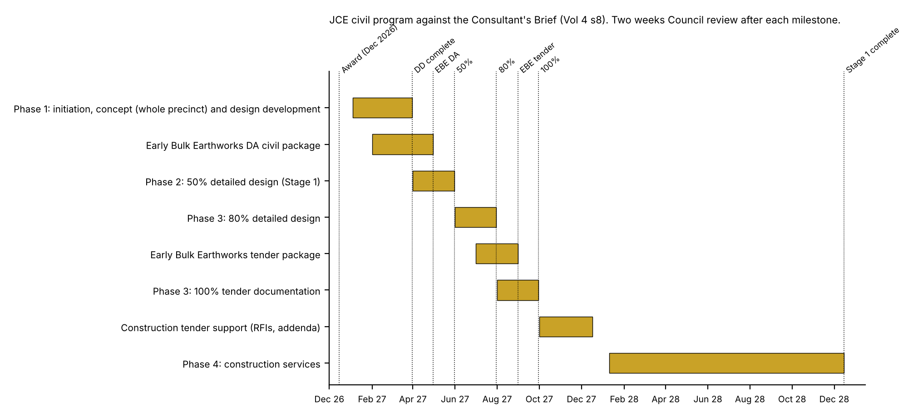

# JCE Infrastructure Pty Ltd
Civil and Hydraulic Engineering  
ABN 29 699 165 663 | 0477 207 027 | jayden@jceinfrastructure.com.au | jceinfrastructure.com.au

## FEE PROPOSAL: CIVIL ENGINEERING SUB-CONSULTANT
Camden Council RFT T026/2026, Design Consultancy Services, Leppington Community Centre Precinct, with JCE's inputs to the Volume 5 returnable schedules

| Item | Detail |
|---|---|
| Proposal no | FP-[TBC - Jayden] (Rev G, Final) |
| Date | 12/10/2026 (for issue to the Lead Architect by 21/10/2026) |
| Client | [Lead Architect], Lead Design Consultant for Camden Council RFT T026/2026 |
| Attention | [Name], [Position] |
| Principal | Camden Council |
| Project | RFT T026/2026 Design Consultancy Services, Leppington Community Centre Precinct (LOSP Project 6): Civil Engineering, with optional Hydraulic Services |
| Site | 116 Heath Road, Leppington NSW 2179 (Lot 30 DP 1266077) |
| Tender closes | Wed 04/11/2026, 3:00pm (buy.nsw). Questions close Wed 28/10/2026, 3:00pm |
| Prepared and reviewed by | Jayden Callen, Director |

Dear [First name],

JCE Infrastructure Pty Ltd (JCE) offers this fee proposal for the civil engineering services in your team for Camden Council's RFT T026/2026, Design Consultancy Services for the Leppington Community Centre Precinct. JCE's civil design will be led and signed off by Jayden Callen personally, who will be your single point of contact. Jayden's background is multidisciplinary design management: coordinating civil, services and specialist inputs into one package to one program, including clash checking of consultant models in Civil 3D and Navisworks on a $250 million Defence facility. He has also shortlisted consultants for a council RFT, so he knows what a council panel looks for.

The fees drop straight into the Civil row of RFT Schedule 3. Hydraulic services are priced as a separate option for the Hydraulics row. Attachment C contains JCE's completed inputs to your Volume 5 returnable schedules (Schedules 2 to 6, 7 to 11, 13 and 15, and a conflicts of interest statement), ready to paste into your submission. A rebuilt Volume 5 file with JCE's entries is supplied with this proposal.

## 1.0  Project understanding

Camden Council is seeking an architect-led design team for the Leppington Community Centre Precinct (LOSP Project 6, Site 1A3) at 116 Heath Road, Leppington, on the corner of Heath Road and Rickard Road. The precinct occupies about 12,000 m2 of the 3.41 ha Council lot (Addendum 2). It comprises a community centre of about 485 m2 in three zones, an arrival plaza, car parking, shared paths and pedestrian links, outdoor community and cultural event spaces, lawns, tree planting and external services.

The total project budget is $10.0 million including fees, so construction is staged: an Early Bulk Earthworks package for on-site contamination management, then Stage 1 (parking and arrival plaza, Zones 1 and 2 and associated external works), then Stage 2 (Zone 3 and the remaining external works). Under Addendum 1 the concept covers the whole facility, while detailed design and tender documentation cover Stage 1 and the earthworks package. Stage 1 construction must be complete by December 2028 under the funding agreement.

The civil challenges on this site are mostly about levels:

- Contamination is to be managed on site in containment cells under capping, which is likely to lift levels next to Scalabrini Creek behind a retaining wall. Council is still preparing the Remediation Action Plan (RAP) and a preliminary geotechnical report.
- Heath Road along the southern frontage is being raised (construction from early 2027). The widened Rickard Road reserve on the western boundary is still in private ownership.
- GroupGSA's Scalabrini Creek open-space design (about 50% complete) and the LOSP Project 5 works set the eastern and northern edges (Vol 4 s13).
- The car park, plaza and paths need accessible grades, and the building roof and hardstand must drain to a lawful point of discharge that meets Council's water quality targets (MUSIC-Link).

The brief asks the civil engineer for stormwater tie-in connections, the site stormwater arrangement and disposal of the building's roof drainage; authority liaison on tie-ins; support to Council in developing site levels and plans for the Early Bulk Earthworks DA; civil drawings and NATSPEC-based specifications in the tender sets; and Safety in Design input. JCE will provide these as a sub-consultant to the Lead Architect under the same conditions of engagement as the head contract (amended AS 4122-2010), subject to Section 12.0.

This proposal is based on RFT Volumes 1 to 5, Attachments B to E and Addenda 1 (07/10/2026) and 2 (08/10/2026).

## 2.0  Scope of services and methodology

JCE's services follow the four phases of RFT Schedule 3. JCE will hold one Civil 3D model of the existing surface, the finished levels, the containment cells and the drainage network from concept to tender, so the DA package, the cost plan and the tender drawings use the same levels and quantities.

### Phase 1: Project initiation, concept design and design development (including the Early Bulk Earthworks DA package)

- Inception meeting, review of the brief and civil input to the return brief; fortnightly online design meetings (8 allowed)
- One half-day site inspection with the design team
- Review of the existing survey (Attachment B), the Concept Design Report (Attachment C), the Data Gap Investigation (Attachment E), the RAP and preliminary geotechnical report when issued, the Heath Road and Rickard Road design levels, and the GroupGSA open-space interface
- Existing services and DBYD review; stormwater authority enquiries and identification of tie-in points and any upgrades needed
- Civil input to at least three layout options and to the construction staging options: vehicle access, car park layout, levels, drainage strategy and earthworks implications
- Site levels and bulk earthworks strategy: Civil 3D surface model of the containment cells and capping, cut and fill balance, and the creek-side retaining interface, developed with Council and its remediation consultant
- Stormwater strategy: catchment plan, on-site detention check against Council requirements, WSUD treatment train and MUSIC-Link water quality model, coordinated with the Project 5 biobasins and the Scalabrini Creek works by others
- Early Bulk Earthworks DA package: civil drawings, erosion and sediment control plan, and a civil and stormwater report sufficient for the DA, with a response to one consolidated DA request for information
- Design development of the car park, arrival plaza and path pavements, grading and drainage layout; civil quantities for the cost plan; preliminary Safety in Design input

### Phase 2: 50% detailed design documentation (Stage 1)

- Stormwater network design (DRAINS): pits, pipes, overland flow paths, any OSD or WSUD elements, and tie-in of the building roof drainage from the hydraulic design
- Pavement design and detailed grading of the car park, arrival plaza and shared paths, with accessible gradients and crossfalls to AS 1428.1 and car park geometry to AS/NZS 2890.1 and 2890.6
- Coordination of civil services and tie-ins with the hydraulic, electrical and authority designers (Water Services Coordinator and ASP3 designer by others)
- 50% civil drawing set, outline NATSPEC civil specification, updated civil quantities for the cost plan and Safety in Design register update
- Response to one consolidated set of Council comments; fortnightly online design meetings (4 allowed)

### Phase 3: 80% and 100% detailed design and tender documentation (Stage 1 and Early Bulk Earthworks tender package)

- 80% and 100% civil tender drawing sets for Stage 1, developed from the 50% set and consolidated Council comments
- Early Bulk Earthworks tender package: drawings, specification and schedules
- NATSPEC civil specification covering earthworks, the containment interface, drainage, pavements and erosion and sediment control
- Final civil calculations, civil design report, Safety in Design report input and civil quantities for the QS at 50%, 80% and pre-tender
- Attendance at the clash resolution day; tender-period RFI responses and addenda for both packages; fortnightly online design meetings (6 allowed)
- Written attestation of senior review and cross-checking (Vol 4 s15) and civil design certification

### Phase 4: Construction services

- Responses to construction RFIs and review of civil shop drawings, samples and substitutions (allowance for both packages; contractor alternatives reviewed at the Schedule of Rates, as the brief provides)
- Four site inspections with a short report each: earthworks and capping hold point, drainage before backfill, pavement subgrade, and practical completion with a defects list and one re-inspection. Each is priced at the fixed $1,900 inspection fee, so the Phase 4 fee can be adjusted on actual attendance as Vol 4 s20 requires
- Online construction meetings (6 allowed); review of work-as-executed information and civil construction certification

### Optional: Hydraulic services (Schedule 3 row Hydraulics)

- Hydraulic concept strategy: sanitary drainage, cold and hot water, rainwater reuse and roof drainage; feasibility input to the Water Services Coordinator (by others)
- 50%, 80% and 100% hydraulic design and documentation to AS/NZS 3500 and NCC Volume Three, with NATSPEC hydraulic specification and fixture schedule
- Construction RFIs, shop drawing review, two site inspections and hydraulic certification
- Fire services, the Sydney Water Section 73 application and ASP3 electrical design are not included

### How JCE will manage the civil design

- One program: JCE's civil activities and hold points are set against your master program and the Vol 4 s8 milestones (Section 4.0).
- Inputs register: JCE will keep a register of the information it needs from Council, the remediation consultant and your team, with dates, and report it in your monthly progress report so delays are visible early.
- Review before issue: every civil issue is checked by Jayden, and the levels, earthworks and stormwater design are independently reviewed by Livio Chiarot FIEAust before each major milestone. JCE provides the written attestation of senior review and cross-checking required by Vol 4 s15 at each issue.
- Coordination: JCE will federate the civil model with your architectural, landscape and services models in Navisworks before the 80% and 100% issues and close out clashes before the clash resolution day.
- Comments: one civil comments and actions register across all Council and team comments, with a written close-out for each item.
- Cost: civil quantities go to the QS at each cost plan, and JCE will offer civil value management options (for example earthworks balance, pavement types and drainage layout) where Stage 1 is over budget.

### Civil risks and how JCE will manage them

| Risk | JCE's response |
|---|---|
| RAP and geotechnical report arrive late or change the containment approach | Early workshop with Council and the remediation consultant in Phase 1; levels model built so cell and capping levels can be revised quickly; questions 2 and 3 to Council lodged before 28/10/2026 |
| Precinct levels conflict with raised Heath Road, future Rickard Road or the creek open space | Obtain the road and GroupGSA designs in CAD at inception (question 5 to Council); interface levels agreed in writing at the end of Phase 1 |
| Stormwater treatment and detention responsibility unclear between Project 5 and Project 6 | Confirm with Council (question 4) before the stormwater strategy is fixed; MUSIC-Link model prepared to Council's targets |
| Stage 1 cost exceeds the $10.0 million budget | Civil quantities to the QS at concept, 50%, 80% and pre-tender; value management options for earthworks, pavements and drainage |
| Contaminated material disturbed by civil works | Drainage and service corridors set above the capping where possible; contamination interfaces shown on the drawings and covered in the Safety in Design report |

The fee includes a response to one consolidated set of Council comments at each design stage (consolidated by the Lead Architect) and one consolidated RFI response for the Early Bulk Earthworks DA. Authority and Council liaison will be coordinated through the Lead Architect, consistent with the RFT probity requirements, and is limited to reasonable correspondence and the meetings listed above.

## 3.0  Deliverables

JCE will provide the following, in the formats the brief requires: PDF at milestones, one drawing per PDF with Camden project numbering and revisions from A; DWG in GDA94 and GDA2020 at completion of detailed design and as-built; Word for written documents; NATSPEC-based specifications.

- Phase 1: civil input to the return brief, layout options and staging options; levels and earthworks strategy; stormwater strategy and MUSIC-Link model; civil quantities for the cost plan; Early Bulk Earthworks DA drawings, ESCP and civil and stormwater report; design development civil drawings
- Phase 2: 50% civil drawing set, DRAINS model, outline civil specification, updated quantities and Safety in Design register input
- Phase 3: 80% and 100% civil tender drawing sets for Stage 1; Early Bulk Earthworks tender drawings and specification; NATSPEC civil specification; civil design report and calculations; quantities for the QS; review attestation and civil design certification
- Phase 4: RFI responses, shop drawing review comments, site inspection reports, defects list and civil construction certification

Nominal civil drawing schedule: C-000 cover and index; C-010 general notes; C-100 existing site and demolition; C-150 bulk earthworks and containment cell levels (early works); C-160 cut and fill plan; C-170 earthworks sections; C-200 site layout and set-out; C-300 finished levels and grading; C-400 stormwater drainage plan; C-410 drainage longitudinal sections and pit schedule; C-450 WSUD and OSD details; C-500 pavement plan and details; C-600 erosion and sediment control plan and details; C-700 typical details. Sheets may be combined or split during documentation.

Design status. Drawings and documents are issued for the purpose stated in the transmittal (for example For Review, For DA, For Tender or For Construction) and must not be used for construction unless issued by JCE as For Construction.

Native files. DWG files are issued at the milestones the brief requires. Intellectual property in JCE's documents is dealt with as the head contract requires (Vol 3 cl 17: foreground IP vests in Council). Native Civil 3D models issued for information must be verified by the recipient before use.

## 4.0  Program

JCE will work to the program in the Consultant's Brief (Section 8) and is available to start on award (December 2026 in the brief; services are expected to commence in January 2027 under Vol 1).

*Figure 1: JCE civil program against the Vol 4 s8 milestones.*

| Milestone (Vol 4 s8) | Date | JCE civil deliverable |
|---|---|---|
| 1 Project initiation, concept design and design development | March 2027 | Levels and earthworks strategy, stormwater strategy, DD civil drawings, quantities |
| 2 Early Earthworks DA package | April 2027 | DA civil drawings, ESCP, civil and stormwater report |
| 3 50% detailed design | May 2027 | 50% civil set, DRAINS model, outline specification |
| 4 80% detailed design | July 2027 | 80% civil set, clash close-out |
| 5 Early Earthworks tender package | August 2027 | Tender drawings, specification and schedules |
| 5 100% tender documentation | September 2027 | 100% civil set, NATSPEC specification, report, certification |
| 6 Construction tender procurement | October to December 2027 | Tender RFI responses and addenda |
| 7 Construction stage services | January to December 2028 | RFIs, shop drawings, four inspections, WAE review, certification |

The program allows two weeks for Council review at each milestone. It assumes the RAP and the preliminary geotechnical report are available by the end of January 2027. If they are, JCE can issue the Early Bulk Earthworks DA civil package for your review before the April 2027 milestone [TBC - Jayden]: confirm this commitment. Delays in information from others, authority reviews or third parties may extend the program.

## 5.0  Team, experience and sign-off

Jayden Callen, Director and Principal Civil Engineer (civil lead). BEng (Hons) Civil, Deakin University; MIEAust (EA 11036201); National Engineering Register application in progress. Jayden has more than eight years in civil design, design management and construction support across Defence, local government, land development, stormwater, water and sewer, roads and pavements. He will lead, check and sign off the civil design and be the single point of contact for your team.

- Civil Design Manager and Senior Engineer, Langtree Consulting Engineers, Townsville (03/2025 to 05/2026): managed four civil designers; coordinated flood modelling, electrical and hydraulic sub-consultants into joint-discipline design packages; prepared engineer's estimates and bills of quantities; chaired client and stakeholder meetings.
- SCP Consulting (06/2023 to 03/2025): managed a multidisciplinary design team; primary contact for Lendlease and CPB Contractors on Defence projects at HMAS Watson, RAAF Base Tindal, RAAF Base Townsville and HMAS Cairns; lead BIM services coordinator on AIR7000 Phase 1B Triton Facilities, RAAF Base Tindal (about $250 million), combining consultant models in Civil 3D and Navisworks to clear stormwater and fire main clashes.
- Katherine Aquatics, Katherine NT (about $10 million, design and construct for Sitzler and Katherine Town Council): about 80 per cent of the civil design, including earthworks pads above the 1% AEP flood level, grading, pavements, stormwater and water quality.
- Western Sydney International Airport Business Precinct Stage One (JCE, sub-consultant to Underscore Projects, client AT&L, 2026): managed the design and delivery program for the SRM-01 sewer rising main and the technical review of the contractor's sewage pumping station package (59-item register at Revision F, four hold points).
- RAAF Base Townsville, Defence delivery project: engineering delivery for CPB Contractors (head contractor). Referee: Maverick Partner, CPB Contractors.
- Jayden Callen (while at Langtrees): Floodway rectification, Tablelands Regional Council (QLD): engineering for the rectification of a floodway on Council's road network.
- Jayden Callen (while at Langtrees): Leachate storage facility, Tablelands Regional Council (QLD): engineering for a landfill leachate storage facility, relevant to the containment and liner interfaces on this site. Referee for both Tablelands projects: Darren Quilliam, Tablelands Regional Council.
- Council experience: Jayden has worked for a regional council in Far North Queensland, where he shortlisted consultants for a council RFT.

Livio Chiarot FIEAust, Director, SCP Consulting: independent technical peer review of the levels, earthworks and stormwater documentation before each major issue (reviewer, not certifier). Livio has more than 40 years in civil, hydraulic and fire services engineering.

Additional design and drafting resources: [TBC - Jayden]. The fee is built from about 530 hours across the Director, Senior Engineer, Project Engineer, Design Engineer and CAD roles at JCE's Schedule of Rates. Name any second team member for Schedule 6 only once availability is confirmed.

Sign-off. This is NSW work for a Class 9b community building. RPEQ does not apply, and the tender does not ask for a particular engineering registration. Civil design certification will be issued by Jayden Callen (MIEAust) with independent peer review. If Council asks for CPEng verification of any element, it is available as a provisional sum (Section 8.0).

JCE's capability statement and Jayden's detailed CV are supplied for your Schedules 5 and 6. Project details and referees in Schedule 5 and 13 format are in Attachment C. Projects delivered while Jayden was employed elsewhere are shown as key personnel experience, not as JCE company projects.

## 6.0  Exclusions

Any service, deliverable, approval, certification, investigation, modelling, meeting, site inspection, authority submission or construction-phase service not identified as included is excluded. The following are specifically excluded but can be arranged or quoted on request:

- Architecture, landscape, structural, mechanical, electrical, fire, communications, acoustic, BCA, access, traffic, wayfinding, energy, planning, quantity surveying and PCA services (by others in the Lead Architect's team)
- Hydraulic services, unless the hydraulic option in Section 8.0 is accepted
- Structural design of retaining walls, containment cell liners and capping systems, and the building structure (structural engineer and remediation consultant by others); JCE sets the levels and coordinates the civil interfaces
- Contamination investigation, the RAP, remediation design and specification, validation and site auditor services (by Council and its consultants)
- Geotechnical investigation and reporting, pavement testing and earthworks testing (Council is commissioning the preliminary geotechnical report; JCE will advise on any further investigation needed)
- New or updated feature and level survey (provisional sum in Section 8.0 if required), and service locating or potholing
- Flood modelling or flood impact assessment of Scalabrini Creek, and design of the Project 5 biobasins, creek works or works outside the Project 6 boundary (Addendum 1)
- Design of the Heath Road and Rickard Road works, external road works, and Sydney Water, Endeavour Energy or other authority-designed assets (Water Services Coordinator and ASP3 by others)
- Statement of Environmental Effects, REF or planning reports, and authority lodgement and fees
- Superintendent and contract administration services (Council acts as Superintendent), construction quality assurance and temporary works design
- Site inspections beyond those listed, which are available at the fixed fee per inspection in Section 8.0
- BIM or Revit modelling beyond the PDF, DWG and Navisworks coordination described

JCE is not responsible for construction methods, temporary works, site safety, contractor performance or departures from the design during construction. Phase 4 services are limited to those listed in Section 2.0.

## 7.0  Assumptions and information required

### Information required from the Lead Architect or Council

- The head-contract terms that will flow down to JCE, and the sub-consultant agreement
- The existing survey in CAD (GDA2020 and AHD), and the Heath Road and Rickard Road design drawings and models
- The RAP, the Data Gap Investigation, the preliminary geotechnical report and the containment cell and capping requirements from Council's remediation consultant
- The Concept Design Report, GroupGSA's Scalabrini Creek open-space design and the Project 5 stormwater and biobasin design (Cardno / ACOR)
- Architectural and landscape layouts in CAD as the design develops, and the hydraulic roof drainage design for tie-in
- Council and authority advice, comments and conditions relevant to the civil scope

JCE is entitled to rely on information provided by the Lead Architect, Council or others on their behalf. Existing services information is indicative only unless confirmed by survey, potholing or service location.

### Assumptions

- JCE is engaged as a sub-consultant to the Lead Architect after award, and the fees are conditional on agreeing the sub-consultant agreement and flow-down terms (Sections 11.0 and 12.0)
- Concept design covers the whole precinct; design development, detailed design and tender documentation cover Stage 1 and the Early Bulk Earthworks package only (Addendum 1). Stage 2 documentation would be a variation
- The precinct boundary is Image 3 of the brief and Attachment D R1, with a site area of about 12,000 m2 (Addendum 2)
- Containment cells, capping and the creek-side retaining wall are designed by others; JCE develops the levels and earthworks and coordinates the interfaces
- Stormwater from the precinct can drain to the existing or Project 5 drainage system without trunk drainage upgrades outside the boundary, with downstream capacity confirmed by Council
- One Early Bulk Earthworks DA is lodged by Council with one consolidated RFI response; the main works proceed under Part 5 / REF as the brief anticipates
- Design meetings are online, as the brief anticipates; one site inspection is included in Phase 1 and four in Phase 4
- Fees are fixed lump sums for the program in the brief with no escalation; if construction services extend beyond December 2028, JCE may seek an adjustment

## 8.0  Fee schedule

JCE offers the civil scope as lump sums for each Schedule 3 phase. Each phase fee covers that phase's meetings, site inspections, travel, reporting, Safety in Design input and design certification.

| Phase | Description of works | Fee (excl. GST) |
|---|---|---|
| Phase 1 | Project initiation, concept design (whole precinct) and design development; levels and earthworks strategy; stormwater strategy and MUSIC-Link; Early Bulk Earthworks DA package | $39,110.00 |
| Phase 2 | 50% detailed design documentation (Stage 1): DRAINS design, pavements and grading, outline specification | $19,100.00 |
| Phase 3 | 80% and 100% detailed design and tender documentation (Stage 1), Early Bulk Earthworks tender package, NATSPEC civil specification, certification | $27,420.00 |
| Phase 4 | Construction services: RFIs, shop drawing review, four site inspections (4 x $1,900), WAE review and certification | $15,020.00 |
|  | Civil total (excl. GST) | $100,650.00 |
|  | GST (10%) | $10,065.00 |
|  | Civil total (incl. GST) | $110,715.00 |

### Option: Hydraulic services

| Phase | Description of works | Fee (excl. GST) |
|---|---|---|
| Phase 1 | Hydraulic concept strategy and design development input | $4,480.00 |
| Phase 2 | 50% hydraulic design and drawings | $7,580.00 |
| Phase 3 | 80% and 100% hydraulic documentation, specification and certification | $9,120.00 |
| Phase 4 | Construction RFIs, shop drawing review, two site inspections (2 x $1,900) and certification | $6,320.00 |
|  | Hydraulics option total (excl. GST) | $27,500.00 |
|  | GST (10%) | $2,750.00 |
|  | Hydraulics option total (incl. GST) | $30,250.00 |

### Schedule 3 transposition (excl. GST)

| Schedule 3 row | Phase 1 | Phase 2 | Phase 3 | Phase 4 | Total |
|---|---|---|---|---|---|
| Civil | $39,110 | $19,100 | $27,420 | $15,020 | $100,650 |
| Hydraulics (option) | $4,480 | $7,580 | $9,120 | $6,320 | $27,500 |
| Civil and hydraulics | $43,590 | $26,680 | $36,540 | $21,340 | $128,150 |

### Schedule of rates for RFT Schedule 3 (excl. GST)

| Key personnel | Hourly rate | Site inspection (fixed) |
|---|---|---|
| Jayden Callen, Director and Principal Civil Engineer | $200 | $1,900 |
| Independent peer review (Livio Chiarot FIEAust) | $200 | N/A |
| Senior Engineer | $190 | $1,900 |
| Project Engineer | $180 | $1,900 |
| Design Engineer | $170 | N/A |
| CAD / Drafting Technician | $160 | N/A |
| Administration / Document Control | $140 | N/A |

The fixed site inspection fee covers travel from northern NSW, the inspection and a short report. These rates are the rates used to build the lump sums.

### Provisional sums (not in the lump sums; drawn only with written approval)

| Item | Provisional sum | Amount (excl. GST) |
|---|---|---|
| PS1 | Supplementary detail survey, if Council's survey needs updating after the Heath Road works | $3,500.00 |
| PS2 | Independent CPEng design verification of retaining and containment-interface elements, if Council requires it | $2,500.00 |
|  | Total provisional sums (excl. GST) | $6,000.00 |

All fees are in Australian dollars and exclude GST.

## 9.0  Payment terms

JCE will claim monthly in line with the head-contract claim cycle (claims on the 25th of each month) for the work completed in each phase. Payment is due within five business days of the Lead Architect receiving payment from Council for JCE's work, and in any case within 30 days of JCE's claim. Invoices are payable without set-off or deduction. Overdue amounts may accrue interest under Attachment A.

## 10.0  Variations and additional services

Services beyond the agreed scope will be carried out at the Schedule of Rates (Attachment B), with prior written approval. Additional fees may apply where there is:

- A change to the precinct boundary, layout, staging or extent of Stage 1, or documentation of Stage 2
- A change to the containment and capping approach, the RAP or the retaining wall concept after levels are set
- Further layout options, or redesign after a stage has been accepted
- A change to Council or authority requirements or the approval pathway, including a full DA for the main works
- Additional comment rounds, RFIs, meetings or site inspections beyond those included
- Construction services beyond December 2028, or for more than the two construction packages described

## 11.0  Insurance

The head contract (Vol 3 Annexure Part A Items 11 to 13, clause 20) requires Public Liability of $20 million each and every claim, motor vehicle cover (comprehensive and CTP) of $20 million, Professional Indemnity of not less than $10 million each and every claim held for 7 years after the Term, and workers compensation as required by law. Clause 20.1(c) applies these to sub-consultants. JCE's position:

| Insurance | Required | JCE position |
|---|---|---|
| Public Liability | $20 million each and every claim | JCE holds $10 million (Pacific Indemnity, policy 05-ENG-I-0077656, to 02/07/2027) and will lift it to $20 million on award, with a certificate of currency before services start |
| Professional Indemnity | Not less than $10 million each and every claim, 7 years after the Term | JCE holds $10 million any one claim, $20 million aggregate (same policy, to 02/07/2027) and will maintain PI for 7 years after the Term [TBC - Jayden]: confirm with Webber the policy meets the each and every claim wording |
| Motor vehicle | $20 million, comprehensive and CTP | [TBC - Jayden]: current cover is a personal NRMA policy (third party fire and theft, $20 million liability). Either arrange compliant cover or list the departure in Attachment C2 |
| Workers compensation | As required by law | [TBC - Jayden]: icare certificate of currency, or a statement that JCE has no workers and is not required to hold a policy |

Insurers must be rated A- or better by S&P (except workers compensation and CTP) [TBC - Jayden]: confirm the underwriter rating with Webber. Certificates will be supplied within 48 hours of a request, as the contract requires.

## 12.0  Liability and head-contract flow-down

JCE accepts the head-contract conditions as they relate to its own services, on a back-to-back basis. JCE's total aggregate liability is limited to the greater of the fees paid or payable to JCE under the sub-consultant agreement and the insurance proceeds recovered or recoverable by JCE, the same basis as clause 19.2 of the amended AS 4122.

Under the head contract the clause 19.1 indemnity sits outside the cap and proportionate liability is excluded (clause 19.4). JCE asks that these be discussed when the sub-consultant agreement is prepared. If you are listing departures in Schedule 2, JCE's proposed entries are in Attachment C2 [TBC - Jayden]: decide whether to request them.

## 13.0  Order of precedence

- The sub-consultant agreement with the Lead Architect (including head-contract flow-down terms as agreed)
- This fee proposal and scope of services
- The fee schedule
- The Terms and Conditions (Attachment A), to the extent not inconsistent with the above

## 14.0  Validity

This proposal is valid for 120 days from the RFT closing date of 04/11/2026 (to 04/03/2027), matching the tender offer validity, and may be extended by agreement. It is conditional on JCE's written acceptance of the head-contract or flow-down terms proposed to apply.

## 15.0  Offer and acceptance

JCE offers to provide the services in this proposal for the fees in Section 8.0. To accept, please sign below and return a copy. JCE will be engaged as soon as practicable after award of the head contract, as the brief requires.

| Offered by | Accepted for and on behalf of the Lead Architect |
|---|---|
| Jayden Callen, BEng (Hons), MIEAust, Director, JCE Infrastructure Pty Ltd | [Name], [Position], [Lead Architect] |
| [signature]  Date: ____/____/2026 | Signature: ________  Date: ____/____/2026 |

Please contact me directly with any questions.

Yours faithfully,

Jayden Callen  
Director, JCE Infrastructure Pty Ltd  
0477 207 027  |  jayden@jceinfrastructure.com.au

## Attachment A  Terms and Conditions

1  Engagement. JCE Infrastructure Pty Ltd (JCE) will provide the consulting services described in the accompanying Fee Proposal, together with any further services agreed in writing (the Services). The Fee Proposal, these Terms and Conditions and any attachments form the agreement between JCE and the Client (the Agreement). The order of precedence in the Fee Proposal applies. Where a sub-consultant agreement with head-contract flow-down terms is signed, it prevails over these terms.

2  Standard of care. JCE will perform the Services with the skill, care and diligence reasonably expected of a competent consultant providing services of a similar nature at the time they are provided.

3  Client's obligations and reliance. The Client will provide JCE, free of charge and in a timely manner, with the information, documents, instructions, approvals and reasonable site access necessary to perform the Services. JCE is entitled to rely on the accuracy and completeness of information provided by or on behalf of the Client.

4  Existing services information. Existing services information is based on records provided by others and is indicative only unless confirmed by survey, potholing or physical service location.

5  Fees and payment. The Client will pay JCE the fees set out in the Fee Proposal, plus GST, on the payment terms stated, without set-off or deduction. Overdue amounts may accrue interest at 2% above the Reserve Bank of Australia cash rate, calculated daily from the due date until paid.

6  Variations. A change to the scope, program or assumptions on which the fee is based may result in an adjustment to the fee or program. JCE will not start varied work until the variation and its commercial effect are agreed in writing, except where the Client instructs JCE to proceed, in which case the varied work is charged at JCE's Schedule of Rates.

7  Design status and use of documents. Documents are issued for the purpose stated in the transmittal and must not be used for construction unless issued by JCE as For Construction. The Client must not rely on superseded or draft issues.

8  No construction responsibility. Unless expressly included, JCE is not engaged to provide construction supervision, superintendent services, contractor management, temporary works design, work health and safety management or construction quality assurance, and is not responsible for construction methods, site safety, contractor performance or departures from the design during construction.

9  Intellectual property. Intellectual property in JCE's documents is dealt with as the head contract requires. Native files issued for information must be verified by the recipient before use.

10  Third-party reliance. No third party may rely on JCE's documents without JCE's prior written consent, other than Camden Council as Principal under the head contract.

11  Limitation of liability. To the extent permitted by law, JCE's total aggregate liability arising out of or in connection with the Agreement or the Services is limited as stated in Section 12.0 of the Fee Proposal. JCE is not liable for indirect or consequential loss, including loss of profit, revenue, use or opportunity.

12  Australian Consumer Law. Nothing in the Agreement excludes, restricts or modifies any guarantee, right or remedy that cannot lawfully be excluded.

13  Confidentiality. Each party will keep the other's confidential information confidential and use it only for the purposes of the Agreement, except where disclosure is required by law, the information is public, or the other party consents in writing.

14  Insurance. JCE maintains Professional Indemnity insurance of $10 million any one claim and Public Liability insurance of $10 million, and will lift Public Liability to $20 million for this engagement on award. Certificates of currency are available on request.

15  Sub-consultants. JCE may engage sub-consultants or registered engineers to assist with, review or verify specialist aspects of the Services, with the Client's approval where the head contract requires it.

16  Suspension and termination. Either party may terminate the Agreement on fourteen (14) days' written notice if the other is in material breach and has not remedied it within that period, or immediately on the insolvency of the other party. If the head contract is terminated, the Agreement ends on the same date. On termination the Client will pay JCE for Services performed up to the date of termination.

17  Dispute resolution. The parties will attempt in good faith to resolve any dispute by negotiation and, failing resolution within fourteen (14) days, by mediation before starting litigation. This clause does not prevent JCE from recovering money owing or seeking urgent interlocutory relief.

18  Assignment. Neither party may assign its rights or obligations under the Agreement without the other's prior written consent, which will not be unreasonably withheld.

19  Governing law. The Agreement is governed by the laws of New South Wales.

## Attachment B  Schedule of Rates

| Role | Rate (excl. GST) |
|---|---|
| Director / Principal Engineer | $200/hr  /  $1,600/day |
| Independent Peer Review | $200/hr  /  $1,600/day |
| Senior Engineer | $190/hr  /  $1,520/day |
| Project Engineer | $180/hr  /  $1,440/day |
| Design Engineer | $170/hr  /  $1,360/day |
| CAD / Drafting Technician | $160/hr  /  $1,280/day |
| Administration / Document Control | $140/hr  /  $1,120/day |
| Additional site inspection, Leppington (including travel and report) | $1,900 each |
| Sub-consultant services (survey, CPEng verification) | At cost plus 10% |

Rates exclude GST. A day is eight hours. Rates hold for the term of the head contract [TBC - Jayden]: confirm, or state annual review.

## Attachment C  JCE inputs to the Volume 5 returnable schedules

For the Lead Architect to paste into its Volume 5 response. Text is written in JCE's name so it can sit under a Civil Engineer heading. A rebuilt Volume 5 file with these entries is supplied as RFT-T026-2026_-Volume-5-Returnable-Schedules_JCE_FILLED.docx.

### C1  Schedule 3: Fee proposal, Civil row and schedule of rates

Civil: Phase 1 $39,110; Phase 2 $19,100; Phase 3 $27,420; Phase 4 $15,020; total $100,650 excl. GST. Hydraulics (if JCE is engaged for it): Phase 1 $4,480; Phase 2 $7,580; Phase 3 $9,120; Phase 4 $6,320; total $27,500 excl. GST. Rates as in Section 8.0. Fixed site inspection fee $1,900 excl. GST including travel and report.

### C2  Schedule 2: Proposed departures for the civil sub-consultant (for decision)

| Clause | Proposed departure | Reason | Price change |
|---|---|---|---|
| Annexure Part A Item 12 / cl 20.1(c) | Sub-consultant motor vehicle cover: $20 million third party property damage plus CTP in place of comprehensive cover [TBC - Jayden] | Civil sub-consultant visits site only for the listed inspections | Nil |
| cl 19.1 and 19.2 | Sub-consultant indemnity to sit within the clause 19.2 cap [TBC - Jayden] | Keeps sub-consultant liability insurable and proportionate to its fee | Nil |
| cl 19.4 | Proportionate liability under Part 4 of the Civil Liability Act 2002 (NSW) to apply to the sub-consultant [TBC - Jayden] | Each consultant answers for its own share of any loss | Nil |

Public Liability is not listed as a departure because JCE will lift it to $20 million on award.

### C3  Schedule 4: Company insurance statement (JCE)

| Policy | Cover per claim | Insurer / policy no. | Expiry |
|---|---|---|---|
| Public / Product Liability | $10 million held; lifting to $20 million on award | Pacific Indemnity, 05-ENG-I-0077656 | 02/07/2027 |
| Professional Indemnity | $10 million any one claim ($20 million aggregate) | Pacific Indemnity, 05-ENG-I-0077656 | 02/07/2027 |
| Compulsory Third Party / motor | $20 million liability (third party fire and theft) [TBC - Jayden] | NRMA, MOTN0007785351 (personal policy) [TBC - Jayden] | 18/09/2027 |
| Workers compensation | [TBC - Jayden] | [TBC - Jayden] | [TBC - Jayden] |

Certificates attached: JCE_Certificate_of_Currency_PI-PL_to_02-07-2027.pdf. The NRMA certificate is a personal policy containing personal details; do not attach it until Jayden confirms [TBC - Jayden].

### C4  Schedule 5: Relevant experience (civil engineer)

Only the WSI project was delivered by JCE as a company. The other projects are Jayden Callen's experience as key personnel with previous employers; the architect should present them in the key personnel or CV field if Schedule 5 is read as company projects only.

| Item | Detail |
|---|---|
| Project and location | Katherine Aquatics, Katherine NT |
| Client | Sitzler (design and construct) for Katherine Town Council |
| Value and size | About $10 million; size (m2) [TBC - Jayden] |
| Dates | [TBC - Jayden] |
| Works | About 80 per cent of the civil design: earthworks pads raised above the 1% AEP flood level, grading, pavements, stormwater and water quality |
| Team | Jayden Callen, civil designer (employer [TBC - Jayden]) |
| Referee | [TBC - Jayden] |

| Item | Detail |
|---|---|
| Project and location | Floodway rectification, Tablelands Regional Council (QLD) |
| Client | Tablelands Regional Council |
| Value, size and dates | Available on request |
| Works | Engineering for the rectification of a floodway on Council's road network |
| Team | Jayden Callen (while at Langtrees); key personnel experience, not a JCE company project |
| Referee | Darren Quilliam, Tablelands Regional Council. Contact details available on request |

| Item | Detail |
|---|---|
| Project and location | Leachate storage facility, Tablelands Regional Council (QLD) |
| Client | Tablelands Regional Council |
| Value, size and dates | Available on request |
| Works | Engineering for a landfill leachate storage facility |
| Team | Jayden Callen (while at Langtrees); key personnel experience, not a JCE company project |
| Referee | Darren Quilliam, Tablelands Regional Council. Contact details available on request |

| Item | Detail |
|---|---|
| Project and location | AIR7000 Phase 1B MQ-4C Triton Facilities, RAAF Base Tindal NT |
| Client | Department of Defence, through the managing contractor [TBC - Jayden] |
| Value and size | About $250 million |
| Dates | Within 06/2023 to 03/2025 (SCP Consulting) [TBC - Jayden] |
| Works | Lead BIM services coordinator: combined external consultant models in Civil 3D and Navisworks to deconflict gravity stormwater and pressure fire mains |
| Team | Jayden Callen (SCP Consulting) |
| Referee | Livio Chiarot FIEAust, Director, SCP Consulting, 0418 150 028, livio.chiarot@scpconsult.com.au [TBC - Jayden]: confirm for this project |

| Item | Detail |
|---|---|
| Project and location | Western Sydney International Airport Business Precinct Stage One, Western Sydney NSW |
| Client | AT&L, through Underscore Projects (JCE sub-consultant) |
| Value and size | [TBC - Jayden] |
| Dates | 2026 |
| Works | Managed the design and delivery program for the SRM-01 sewer rising main; technical review of the design and construct contractor's sewage pumping station package (review register SPS-REG-001, 59 items at Revision F, four hold points) |
| Team | Jayden Callen (JCE); Livio Chiarot (technical reviewer) |
| Referee | Underscore Projects contact [TBC - Jayden] |

| Item | Detail |
|---|---|
| Project and location | RAAF Base Townsville, Defence delivery project |
| Client | CPB Contractors (head contractor) |
| Value, size and dates | Available on request |
| Works | Engineering delivery for CPB Contractors (head contractor) |
| Team | Jayden Callen |
| Referee | Maverick Partner, CPB Contractors. Contact details available on request |

| Item | Detail |
|---|---|
| Project and location | HMAS Watson redevelopment, Watsons Bay NSW |
| Client | Department of Defence, with Lendlease as managing contractor [TBC - Jayden] |
| Value and size | [TBC - Jayden] |
| Dates | Within 06/2023 to 03/2025 (SCP Consulting) [TBC - Jayden] |
| Works | Construction phase civil design of road geometry, pavement sections, bulk earthworks and grading; civil design coordination and RFI management with the tier-one contractor |
| Team | Jayden Callen (SCP Consulting) |
| Referee | Livio Chiarot FIEAust (as above) [TBC - Jayden] |

### C5  Schedule 6: Key personnel (civil)

| No. | Name | Position | Qualification | Experience and accreditation | % time |
|---|---|---|---|---|---|
| 1 | Jayden Callen | Director and Principal Civil Engineer, JCE (civil lead and sign-off) | BEng (Hons) Civil; MIEAust (EA 11036201); NER application in progress | 8+ years civil design, design management and construction support: Defence, local government, land development, stormwater, roads and pavements | About one third of full time from January to September 2027 (about 490 hours), then as required in 2028 [TBC - Jayden] |
| 2 | Livio Chiarot | Independent peer reviewer (SCP Consulting) | FIEAust | 40+ years civil, hydraulic and fire services engineering | Review before each major issue |

Current commitments of key personnel: [TBC - Jayden] (list JCE's live commissions and expected hours).

Organisation chart entry: Lead Architect > Civil Engineer: JCE Infrastructure (Jayden Callen, civil lead) > independent peer review: Livio Chiarot FIEAust; hydraulics (if engaged): JCE Infrastructure.

### C6  Schedule 7: Project appreciation, civil input

Site and outcomes. The 12,000 m2 precinct sits on contaminated land at the corner of Heath Road and Rickard Road, between the raised Heath Road, a future widened Rickard Road and the Scalabrini Creek open space. The civil outcome Council needs is a set of finished levels that contain the contamination under capping, give accessible grades to the plaza, car park and paths, match the road and open-space edges, and drain to a lawful outlet with MUSIC-Link compliant treatment, within the Stage 1 budget.

Constraints: contamination and the RAP still in preparation; levels raised behind a creek-side retaining wall; Heath Road raising in 2027; Rickard Road widening land in private ownership; Project 5 biobasins and creek works outside the boundary; $10.0 million total budget including fees.

Opportunities: a balanced earthworks design that uses the containment fill to form the plaza and car park platforms; passive WSUD in landscape areas; one civil model shared with the architect, landscape architect and QS so options and staging can be priced quickly.

### C7  Schedule 8: Design management and methodology, civil input

Use Section 2.0 (How JCE will manage the civil design, and the civil risks table). In short: one civil program tied to the master program; an inputs register reported monthly; review by Jayden and independent peer review before each major issue, with the Vol 4 s15 written attestation; Navisworks federation and clash close-out before the 80% and 100% issues; one comments register with written close-out; civil quantities to the QS at each cost plan and value management options for earthworks, pavements and drainage.

### C8  Schedule 9: Program, civil input

Use Figure 1 and the milestone table in Section 4.0. JCE meets every Vol 4 s8 milestone and allows two weeks for Council review at each.

### C9  Schedule 10: Sub-consultants, Civil row

| Discipline | Sub-consultant | Locality | Experience with this consultant | % of project cost |
|---|---|---|---|---|
| Civil (and Hydraulics if engaged) | JCE Infrastructure Pty Ltd (ABN 29 699 165 663) | Northern NSW; design delivered remotely with site attendance for inspections | [Lead Architect to complete] | [Lead Architect to complete] |

### C10  Schedule 11: WHS questionnaire, JCE documents

| Item | JCE evidence |
|---|---|
| Enforcement notices or prosecutions in the last 3 years | N/A (none) [TBC - Jayden]: confirm |
| Third party certified quality or environmental system (ISO 9001, 14001) | No. JCE has a documented quality policy (JCE-QMS-POL-001) and environmental policy (JCE-ENV-POL-001) |
| Third party certified WHS system (ISO 45001 or similar) | No. JCE has a documented WHS management system (22/06/2026) |
| WHS policy | JCE-WHS-POL-001 Work Health and Safety Policy |
| Responsibility statements | JCE WHS Management System (22/06/2026); JCE-WHS-PLN-001 WHS Management Plan |
| Incident and near miss procedure and forms | JCE-WHS-PRO-003; JCE-WHS-FRM-001 |
| Training and induction | JCE-WHS-PRO-008 Worker WHS Induction; JCE-WHS-REG-003 Training and Competency Register |
| Drug and alcohol policy | JCE-WHS-POL-007 Fitness for Work Policy [TBC - Jayden]: confirm it covers drugs and alcohol |
| WHS consultation procedures | JCE-WHS-PRO-001 Consultation, Cooperation and Coordination Procedure |
| Risk management procedure and example risk assessment | JCE-WHS-PRO-002; example: JCE-WHS-SWMS-001 Safe Work Method Statement |
| Safety monitoring, site audit and inspection schedules | JCE-WHS-PRO-005 Site Inspection and Site Entry Procedure |
| Emergency procedures | JCE-WHS-PLN-002 Emergency Response Plan |

JCE will register on Conserve if directed after award (Vol 2 cl 25).

### C11  Schedule 13: Referees for JCE

| Referee | Details |
|---|---|
| Referee 1 | Brett Langtree, Director and Principal Civil Engineer, Langtree Consulting Engineers. 0400 699 979, brett@langtreeconsulting.com.au. Connection: Jayden's director and direct supervisor, 03/2025 to 05/2026 |
| Referee 2 | Livio Chiarot FIEAust, Director, SCP Consulting. 0418 150 028, livio.chiarot@scpconsult.com.au. Connection: Jayden's supervisor and mentor, 06/2023 to 03/2025; technical reviewer on the WSI rising main, 2026. Note: Livio is also JCE's proposed peer reviewer |
| Referee 3 | Maverick Partner, CPB Contractors. Contact details available on request. Connection: RAAF Base Townsville Defence delivery project (CPB Contractors head contractor) |
| Referee 4 | Darren Quilliam, Tablelands Regional Council. Contact details available on request. Connection: client for the floodway rectification and leachate storage facility projects Jayden delivered while at Langtrees |

[TBC - Jayden]: confirm all referees know about this tender and are available for the four weeks after 04/11/2026. None has a connection to Camden Council.

### C12  Schedule 15 and conflicts of interest (JCE)

| Question | JCE answer |
|---|---|
| Organisation | JCE Infrastructure Pty Ltd, ABN 29 699 165 663. Contact Jayden Callen, 0477 207 027, jayden@jceinfrastructure.com.au. Address [TBC - Jayden] |
| Required to report under the Modern Slavery Act 2018 (Cth)? | No. JCE is below the $100 million consolidated revenue threshold |
| Policies on human rights, ethical sourcing and fair payment? | Yes. JCE-WHS-POL-003 Modern Slavery Policy |
| Activities to detect and manage modern slavery risk in the organisation and supply chain; risk assessment; training | [TBC - Jayden] |
| Countries where products are made | JCE supplies professional services delivered in Australia. Design software is licensed from overseas vendors |
| Conflicts of interest | JCE has no family, business or other relationship with any Camden Council official, contractor or employee involved in this tender, and no interest in the site. JCE will sign any declaration Council issues |

### C13  Contribution to the Camden LGA

JCE is based in northern NSW. Where JCE procures services for this project (for example the provisional survey), it will invite firms based in the Camden LGA or south-west Sydney first [TBC - Jayden]: confirm this commitment.

### C14  Documents supplied with this proposal

- This fee proposal (PDF and Word)
- RFT-T026-2026_-Volume-5-Returnable-Schedules_JCE_FILLED.docx (JCE entries)
- Jayden_Callen_Detailed_CV_2026-09.pdf and JCE Capability Statement - Councils.pdf
- JCE_Certificate_of_Currency_PI-PL_to_02-07-2027.pdf (PL $20 million certificate to follow on award)
- WHS and quality documents listed in C10

## Attachment D  Short CV: Jayden Callen

Jayden Callen (Jayden Caleb Callen-Pell), BEng (Hons) Civil, Deakin University (conferred 12/02/2026); MIEAust, EA 11036201 (admitted 02/07/2026); National Engineering Register application in progress. Director and Principal Engineer, JCE Infrastructure.

- Design management: Civil Design Manager, Langtree Consulting Engineers, Townsville (03/2025 to 05/2026); Senior Engineer and Design Manager, SCP Consulting (to 03/2025), coordinating multidisciplinary packages and external sub-consultants.
- Defence and tier-one delivery: HMAS Watson, RAAF Base Tindal, RAAF Base Townsville and HMAS Cairns with Lendlease and CPB Contractors; site engineer on secondment to CPB for about 10 km of potable and fire water mains and car parks at RAAF Base Townsville.
- Stormwater and water quality: DRAINS, MUSIC X, flood impact assessment to ARR 2019; Katherine Aquatics civil design.
- Roads and pavements: Austroads geometry with Transport for NSW supplements; pavement design with CIRCLY.
- Council civil works (while at Langtrees): floodway rectification and a landfill leachate storage facility for Tablelands Regional Council (QLD).
- 3D and coordination: Civil 3D (advanced, AutoLISP), Navisworks, InfraWorks.

