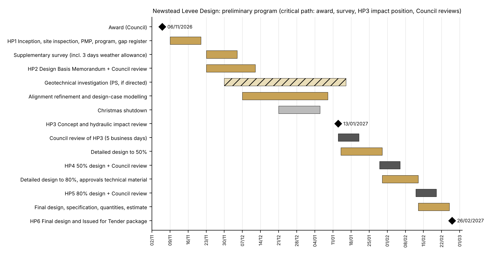

> FINAL Rev G, 12/10/2026. Plain-text copy of JCE_FP_VP527574_Final_RevG.docx for pasting into the JCE branded template. Items marked [TBC - Jayden] must be completed before lodgement.

# JCE Infrastructure Pty Ltd: Fee proposal for Newstead Levee Design 26/27 (RFQ M2025-125), Rev G FINAL

_Our ref: JCE-FP-VP527574 Rev G | Council ref: RFQ M2025-125 (VendorPanel VP527574) | Date: [dd/10/2026]_

Manager Engineering  
Mount Alexander Shire Council  
27 Lyttleton Street, Castlemaine VIC 3450

**Newstead Levee Design 26/27 (RFQ M2025-125): quotation**

Dear Manager Engineering,

JCE Infrastructure Pty Ltd (JCE) submits this quotation for the detailed design, approvals support, documentation and construction tender package for the Newstead levee (Mitigation Option 6b). Jayden Callen, Director, leads the commission personally and is Council's single point of contact. He coordinates the specialist team to one program and one comments register, with a design review before anything reaches Council at each of the six hold points.

**Our main offer fits Council's budget.** The lump sum is **$113,600.00 excluding GST ($124,960.00 including GST)** against the indicative budget of $125,000 including GST (Brief 1.8). It covers every hold point and all 14 deliverables in Brief 1.7. To reach that figure we have:

- designed from the Water Technology TUFLOW model and NCCMA digital terrain data already held by Council, with one design-case modelling set for the preferred alignment and a final impact check;
- limited the supplementary survey to the levee crest, structures and the floor levels needed for impact reporting, with any further survey at the Schedule C item 2.1 day rate;
- carried geotechnical, cultural heritage, ecology, utility locating, contamination and any bespoke structural design as stated provisional sums that proceed only on the Superintendent's written direction (Brief 1.6, RFQ Note 2); and
- kept JCE site attendance to one visit, with local attendance by our Ballarat-based registered engineer and online meetings.

**Alternative A** offers the fuller scope for $237,220.00 excluding GST: two concept alignment iterations, full corridor survey, structural design within the lump sum and a larger drawing set (Section 10.0 and Schedule K).

**The team.** JCE delivers project management and the civil and hydraulic design. Venant Solutions (Melbourne) provides the floodplain modelling and hydraulic impact assessment, led by Registered Professional Engineers (Victoria) whose work includes the Harcourt Flood Study for Mount Alexander Shire. Lotay Civil (Ballarat) directly supervises and approves the civil design as a Registered Professional Engineer (Victoria), as Schedule F requires. A licensed surveyor from central Victoria carries out the supplementary survey.

Jayden has also worked for a regional council in Far North Queensland, where he shortlisted consultants for a council tender. He knows what a Council officer needs after award: clear hold points, no surprises on scope or fee, and records Council can audit.

This quotation is valid for 90 days from the closing date. Please contact me on 0477 207 027 or jayden@jceinfrastructure.com.au with any questions.

Yours faithfully,

[signature]

**Jayden Callen**  
Director, JCE Infrastructure Pty Ltd  
0477 207 027 | jayden@jceinfrastructure.com.au  
Date: [dd/10/2026]

---

## 1.0   PROJECT UNDERSTANDING

**The levee.** Newstead is on the Loddon River about 15 km west of Castlemaine. The 1920s earthen levee on the east bank is about 1.5 km long. Price Merrett Consulting's 2017 risk assessment found it vulnerable to overtopping, slumping, piping and foundation seepage, with the southern section at extreme risk of failure in a 1% AEP event (Brief 1.1). Breaches were reported in 2010, 2011, 2016 and 2022, and the flood study found the levee is overtopped in the 5% AEP event (Brief 1.2).

**Option 6b.** Water Technology's Newstead Flood Study built calibrated RORB (about 1,103 km², 201 sub-areas) and TUFLOW (3 m grid) models. In May 2026 Council endorsed the study and approved the raised, extended and realigned levee, shown in Brief Appendix 2 as Option 6b. The northern end is extended along Mia Mia Creek, with northern and southern alignment options still to resolve; the southern end is realigned; and the Recreation Avenue to Punt Road section was adjusted after community feedback.

**What the design must balance.** In the 1% AEP flood with the study's 2030 climate allowance, Option 6b removes above-floor flooding from most of the 87 benefiting properties, but the study reports flood level increases of up to 400 mm west of the Loddon, about 14 newly affected properties and significantly more fill than other options. Council's objective is a constructible, permit-ready and tender-ready design that resolves those trade-offs, supports NCCMA and other approvals, and gives Council a dependable estimate for construction funding bids.

### Project risks and our response

| Issue | Our response |
|---|---|
| Third-party flood impacts west of the Loddon | Design-case modelling by Venant in Water Technology's calibrated TUFLOW model, testing set-backs, crest profile and a controlled overtopping section. Impacts reported property by property using surveyed floor levels. JCE seeks Council's and NCCMA's acceptance of the impact position at HP3 before detailed design proceeds. |
| Fill volume and construction cost | Least-fill alignment and section, particularly in the southern section and at Mia Mia Creek; reuse of suitable existing levee material; estimates at concept, 50%, 80% and Issued for Tender. |
| A 1920s levee of unknown construction | Geotechnical scope set out in the Design Basis Memorandum (HP2) and priced as a stated provisional sum (PS-A). Seepage, piping and stability checks for flood loading and drawdown; details for burrowing animals, tree roots and penetrations. |
| Drainage through and behind the levee | Inventory of outlets and floodgates; standard precast headwalls with flap gates or penstocks; assessment of local runoff trapped behind the levee during river floods. |
| Fixed completion date of 26/02/2027 | Program built back from 26/02/2027, with survey in late November, concept by 13/01/2027 and five business days for each Council review (Section 6.0). |
| Victorian registration | Civil design under the direct supervision of, and approved by, a Victorian-registered civil engineer; hydraulic assessment by registered Venant engineers (Section 7.0). |
| Budget of $125,000 including GST | Main offer of $113,600 excluding GST with investigations as stated provisional sums, so Council controls each investigation spend at HP2. |

## 2.0   OFFER STRUCTURE

JCE offers two priced scopes. The main offer is entered in Schedule C and is the quoted price. Alternative A is set out in Schedule K for comparison.

| Scope element | Main offer (Schedule C) | Alternative A (Schedule K) |
|---|---|---|
| Lump sum excl. GST | $113,600.00 | $237,220.00 |
| Hold points and deliverables | All six hold points; all 14 deliverables | All six hold points; all 14 deliverables |
| Alignment options at concept | One preferred Option 6b alignment; the northern variant (Codrington Road or Mia Mia Creek) settled by desktop review at HP2 | Two alignment variants taken to concept |
| Hydraulic modelling (Venant) | Model review, one design-case set with one sensitivity, final impact check and report | Two concept iterations, residual risk (breach) scenarios, internal drainage ponding and final report |
| Supplementary survey | Levee crest long section, cross-sections at about 50 m, structures and up to 20 floor levels; NCCMA terrain data elsewhere | Full corridor feature survey (about 40 m wide), up to 50 floor levels and cadastral re-establishment |
| Structures | Standard precast headwalls and proprietary flap gates designed by JCE; bespoke structures under PS-F | Structural design and certification of outlets and any floodwall in the lump sum |
| Drawings | About 21 sheets (5 concept, 16 detailed) | About 38 sheets (10 concept, 28 detailed) |
| JCE site visits | One (inception); concept workshop online | Two (inception and concept workshop or community session) |
| Investigations (geotechnical, heritage, ecology, utility locating, contamination) | Stated provisional sums | Stated provisional sums |

## 3.0   METHODOLOGY AND SCOPE OF SERVICES

The scope follows Brief Sections 1.3 to 1.5 and is grouped by Council's six hold points, so each stage, deliverable and Schedule C line matches. Work marked [Sub] is delivered by a JCE sub-consultant within the lump sum. Work marked [PS] is a stated provisional sum and proceeds only on the Superintendent's prior written direction (RFQ Note 2). Scope added under Alternative A is noted at the end of each stage.

### 3.1   HP1: Inception and information review (Schedule C item 1.1)

- Inception meeting with Council within two weeks of award, and a full-length site inspection of the levee corridor, tie-ins, waterway interfaces, drainage outlets, access, utilities, vegetation and private property interfaces (Brief 1.4 item 2).
- Review with Venant of the Water Technology flood study (reports, GIS and TUFLOW model), the 2017 levee alignment modelling, the GHD 2015 levee investigation, NCCMA digital terrain data, and the LSIO and FO overlays.
- Project Management Plan, program and risk register, and the Inception Report, within 10 business days of award (Brief 1.7 and 1.10).
- Information gap register and investigation plan (deliverable 2); BYDA search and data requests to NCCMA, Coliban Water, the Department of Transport and Planning, Powercor and NBN/Telstra.
- During the inception site inspection JCE flies a drone photogrammetry capture of the levee corridor, giving a geotagged orthophoto and 3D model that records existing crest, batter and outlet condition and serves as the base for concept mapping and community session visuals (orthophoto produced in Autodesk ReCap Pro or DJI Terra).
- JCE processes the capture in Autodesk ReCap Pro into a point cloud and terrain surface of the levee alignment, which feeds the Civil 3D and InfraWorks design model alongside the surveyed levels.

### 3.2   HP2: Design Basis Memorandum (item 1.2)

- Design Basis Memorandum (deliverable 3): design event (1% AEP with the agreed climate allowance), freeboard, crest width and batters, controlled overtopping, materials and compaction, crossings, drainage and floodgates, design life, maintenance access, the standards applied (including the Victorian Levee Management Guidelines 2015) and the certification pathway.
- Desktop comparison of the two northern variants (Codrington Road or closer to Mia Mia Creek) using the existing model results, terrain data and land tenure, with a recommendation for Council to adopt at HP2.
- Investigation requirements for Council's acceptance: supplementary survey [Sub], and the scope, extent and cost of geotechnical [PS-A], cultural heritage [PS-B], ecology and arboriculture [PS-C], utility locating [PS-D] and contamination [PS-E] investigations.
- Approvals pathway (waterway, planning, native vegetation, cultural heritage, road authority, property owner) and the related stakeholder and approval risks.
- Supplementary survey [Sub]: levee crest long section, cross-sections at about 50 m and at grade changes, outlets and structures, and floor levels of up to 20 properties where the design changes flood levels. The drone capture lowers the risk of missed features between surveyed cross-sections, but it does not replace the licensed surveyor's levels, so the survey allowance is unchanged.

### 3.3   HP3: Concept alignment and hydraulic impact review (item 1.3)

- Existing crest compared with design levels to identify deficient sections.
- Refinement of the preferred Option 6b alignment: tie-ins to high ground, the Mia Mia Creek interface, public land preference, constructability, property impacts, fill reduction and reduction of flood level increases west of the Loddon (Brief 1.4 item 4).
- Design-case hydraulic modelling [Sub, Venant]: one design-case set for the preferred alignment with one sensitivity test, flood impact checks and mapping suitable for Council, NCCMA, approval agencies and community communication (deliverable 5, concept stage).
- Concept design report and drawings (deliverable 4): alignment, levels, typical sections, options considered, risks, stakeholder issues and a preliminary cost estimate.
- Concept workshop with Council (online) and mapping and presentation material for one community or stakeholder session.
- Alternative A adds: a second alignment variant and a second modelling iteration, residual risk (overtopping and breach) scenarios, an internal drainage ponding assessment, and JCE attendance in person at the workshop or community session.

### 3.4   HP4: 50% design (item 1.4)

- Embankment design: geometry and zoning, compaction and moisture requirements, seepage control, topsoil and grassing, scour and erosion protection.
- Outlet, drainage and floodgate treatments using standard precast headwalls and proprietary flap gates or penstocks, sized hydraulically by JCE. Any floodwall or bespoke structure identified at HP3 is designed under PS-F by a Victorian-registered structural engineer.
- Road crossings, ramps and maintenance access; services conflicts and protection strategy.
- 50% drawings, updated cost estimate and risk register for Council review (deliverable 6).

### 3.5   HP5: 80% design (item 1.5)

- All drawings developed to 80%, with internal drainage, services protection, erosion and sediment control, reinstatement and construction methodology considerations.
- Draft technical specification and schedule of quantities; updated estimate and risk register (deliverable 7).
- Approvals support: technical material for NCCMA, planning (including native vegetation) and cultural heritage, and attendance at one agency meeting online (deliverable 12).

### 3.6   HP6: Final design and Issued for Tender package (item 1.6)

- Final design report and calculations with native calculation files (deliverable 8).
- Final hydraulic impact assessment and modelling technical note with GIS and model outputs [Sub, Venant] (deliverable 5, final stage).
- Issued for Tender drawings in DWG and PDF (deliverable 9); technical specification and construction tender scope (deliverable 10); schedule of quantities and engineer's estimate (deliverable 11); risk register and hold point schedule.
- Approvals summary, and design certification and verification records signed by the registered design approver (deliverable 13).
- Final project data package and handover register (deliverable 14).

### 3.7   Project management (all stages)

- Jayden Callen is Council's single point of contact. Three-weekly progress reports (Brief 1.10) are issued with a short online meeting.
- One program, one design review register recording each Council comment and its close-out, and document control and transmittals for every issue.
- Sub-consultant management: JCE reviews every sub-consultant output before it reaches Council.

### 3.8   Optional construction-phase support (not in either lump sum)

As Brief 1.4 item 10 allows, tender clarification, tender evaluation advice, design support and RFI responses during construction are offered as separate options in Section 10.0.

## 4.0   STATEMENT OF COMPLIANCE WITH THE BRIEF

RFQ clause 18 (criterion 1.2) asks for a statement of compliance or non-compliance with the specification. JCE's position for the main offer:

| Brief reference | Requirement | JCE position |
|---|---|---|
| 1.4 item 1 | Inception and information review; DBM | Complies (3.1, 3.2) |
| 1.4 item 2 | Site inspection and constraints | Complies (3.1) |
| 1.4 item 3 | Survey and investigations: manage or specify | Complies. Supplementary survey in the lump sum; other investigations specified at HP2 and priced as provisional sums, as Brief 1.6 permits |
| 1.4 item 4 | Alignment refinement of Option 6b | Complies, with one preferred alignment taken to concept (northern variant settled at HP2). Two variants under Alternative A |
| 1.4 item 5 | TUFLOW updates, flood impact checks, mapping | Complies (3.3, 3.6) |
| 1.4 items 6 and 7 | Concept and detailed design | Complies. Bespoke structures under PS-F |
| 1.4 item 8 | Approvals pathway and supporting material | Complies. Approvals support is technical material and meeting attendance; obtaining approvals within the term is outside the Consultant's control (Schedule K item 5) |
| 1.4 item 9 | Construction tender package | Complies (3.6) |
| 1.4 item 10 | Optional construction-phase support | Offered as options O1 to O4 |
| 1.5 | Hold points HP1 to HP6 | Complies; one Schedule C line per hold point |
| 1.7 | Deliverables 1 to 14 and formats | Complies (Section 5.0) |
| 1.8 | Breakdown of costs, hours and team members by task | Complies (Attachment D) |
| 1.9 | Program to 26/02/2027 as a Gantt chart | Complies (Section 6.0) |
| 1.10 | Inception Report and three-weekly reporting | Complies |
| 1.11 | IP vests in NCCMA and Council | Complies, with a clarification on pre-existing background IP (Schedule K item 3) |
| 1.13 | PI $5M, PL $20M, Workcover | PI complies. PL: JCE will lift its cover to $20M on award (Section 15.0). Workers compensation: [TBC - Jayden] |
| Schedule F | Registered designer or supervisor and approver (Vic) | Complies through Lotay Civil and Venant (Section 7.0) |

## 5.0   DELIVERABLES

| No. | Deliverable (Brief 1.7) | Hold point | Format |
|---|---|---|---|
| 1 | Project Management Plan, program and risk register (within 10 business days of award) | HP1 | DOCX, XLSX, PDF |
| 2 | Investigation plan and data gap register | HP1 | DOCX, XLSX, PDF |
| 3 | Design Basis Memorandum | HP2 | DOCX, PDF |
| 4 | Concept design report and drawings | HP3 | DOCX, DWG, PDF |
| 5 | Hydraulic impact assessment and modelling technical note (concept and final) | HP3, HP6 | DOCX, PDF, GIS and model outputs |
| 6 | 50% detailed design package | HP4 | DWG, PDF, DOCX, XLSX |
| 7 | 80% detailed design package | HP5 | DWG, PDF, DOCX, XLSX |
| 8 | Final design report and calculations | HP6 | DOCX, PDF, native files |
| 9 | Issued for Tender drawings | HP6 | DWG, PDF |
| 10 | Technical specification and construction scope | HP6 | DOCX, PDF |
| 11 | Schedule of quantities and engineer's estimate | HP6 | XLSX, PDF |
| 12 | Approvals pathway and supporting technical material | HP2 to HP6 | DOCX, PDF, GIS |
| 13 | Design certification and verification records | HP6 | PDF |
| 14 | Final project data package and handover register | HP6 | Native files, PDF |

All outputs and data vest in NCCMA and Council as Brief 1.11 requires.

**Nominal drawing schedule (main offer).** Sheets may be combined or subdivided.

| Sheet | Title |
|---|---|
| C000 to C002 | Cover, locality plan, drawing index, general notes and legend |
| C100 to C101 | Existing conditions, survey control and existing services |
| C200 | General arrangement and set-out |
| C300 to C304 | Levee plans and longitudinal sections (existing and design crest) |
| C400 to C402 | Typical sections and cross-sections (embankment, tie-ins, controlled overtopping) |
| C500 to C501 | Outlets, floodgates and internal drainage (standard details) |
| C600 | Road crossings, ramps and maintenance access |
| C700 | Erosion and sediment control and environmental controls |

## 6.0   PROGRAM

The program meets Council's fixed date of Friday 26/02/2027 and the Brief's targets for concept (within 8 weeks of inception) and draft detailed design (within 14 weeks of inception).

| Date | Milestone |
|---|---|
| Fri 06/11/2026 | Council's expected award |
| Wed 18/11/2026 | Inception meeting and site inspection (within 2 weeks of award) |
| Fri 20/11/2026 | HP1: Project Management Plan, program, risk register, investigation plan, gap register and Inception Report (10 business days after award) |
| 23/11/2026 to 04/12/2026 | Supplementary survey fieldwork, including 3 working days for weather; data by 11/12/2026 |
| Fri 04/12/2026 | HP2: Design Basis Memorandum issued; Council acceptance by 11/12/2026 |
| 07/12/2026 to 08/01/2027 | Alignment refinement and design-case modelling |
| 21/12/2026 to 05/01/2027 | Christmas shutdown |
| Wed 13/01/2027 | HP3: concept design report, drawings and hydraulic impact review (8 weeks after inception); Council review to 20/01/2027 |
| Fri 29/01/2027 | HP4: 50% design; Council review to 05/02/2027 |
| Fri 12/02/2027 | HP5: 80% detailed design package; Council review to 19/02/2027 |
| Wed 24/02/2027 | Draft final package (14 weeks after inception) |
| Fri 26/02/2027 | HP6: final detailed design and Issued for Tender package, with design certification |

**Critical path:** award date, survey delivery, the HP3 hydraulic impact position and Council's five-day reviews. **Weather and local conditions:** survey and any directed geotechnical fieldwork are planned for late November and December, with 3 working days of weather allowance in the survey window and float before HP3. If award, access to private land or a flood event delays fieldwork, JCE will tell Council within one business day and table a recovery plan. Geotechnical drilling under PS-A needs Council's direction by 27/11/2026 to inform the 50% design.

## 7.0   TEAM, REGISTRATION AND DESIGN APPROVAL

Schedule F requires the designer or supervisor and the design approver to be registered engineers in Victoria. Jayden Callen (BEng (Hons) Civil, Deakin University; MIEAust, EA 11036201; National Engineering Register application in progress) is not registered in Victoria, so the services are delivered as follows:

| Discipline | Who performs | Registered supervisor and approver |
|---|---|---|
| Civil design (levee, drainage, crossings, specification) | JCE (Jayden Callen) | Sunny Lotay, Lotay Civil, Registered Professional Engineer (Vic), Civil, PE [TBC - Jayden] |
| Hydraulic modelling and impact assessment | Venant Solutions | Michael South, RPE (Vic) PE [TBC - Jayden], or Atoosa Towzihian, RPE (Vic) PE [TBC - Jayden] |
| Structural design (PS-F, or Alternative A) | Victorian-registered structural engineer, under its own registration and insurance | [TBC - Jayden] (named on direction) |
| Survey | Licensed surveyor (central Victoria) | [TBC - Jayden] (on quotation) |

**Lead theme: principal-led design management.** Jayden has moved from civil design into design management, coordinating several disciplines into one package to one program. As Civil Design Manager at Langtree Consulting Engineers, Townsville (03/2025 to 05/2026) he managed four civil designers and coordinated flood modelling, electrical and hydraulic sub-consultants into joint-discipline packages, including bridge approaches, culverts and retaining walls, and prepared engineer's estimates and bills of quantities. At SCP Consulting (06/2023 to 03/2025) he was the primary point of contact for tier-one contractors on Defence projects and managed a multidisciplinary design team.

**Levee experience.** JCE inspected and certified the existing earthen levee (about 647 m) at 6887 Oxley Highway, Gunnedah NSW in 2026: condition inspection, field dispersion and plasticity testing, and certification report JCE-INS-001 for a development application under Gunnedah LEP 2012 clause 5.21. Venant's directors bring Victorian floodplain and levee work, including the Harcourt Flood Study in Mount Alexander Shire and the Best Practice for Planning Behind Levees review for the City of Launceston. Short CVs are in Attachment C and full CVs accompany Schedule F.

**Resources and equipment.** JCE's related business, Glide Inside (glideinside.com.au), produces 3D digital models and visualisation for the property and construction sector. JCE delivers drone photogrammetry (orthophotos, 3D models and geotagged inspection imagery) using a DJI Mavic 3 Enterprise with RTK. JCE will deploy a DJI Mavic 3 Enterprise with RTK on this project, operated under CASA's sub-2 kg excluded category, with operator accreditation in place before services start. Jayden has delivered drone photogrammetry on previous projects, processing captures in Autodesk ReCap Pro to build point clouds and terrain surfaces for use in Autodesk InfraWorks and civil design models. The workflow is DJI capture with RTK, ReCap Pro for point clouds and surfaces, InfraWorks and Civil 3D for design integration, and QGIS for GIS and asset register delivery. Flights at Newstead follow CASA's standard operating conditions (visual line of sight, below 120 m, clear of people) and need landowner permission over private land.

## 8.0   QUALITY, DESIGN REVIEW AND NON-COMPLIANCE MANAGEMENT

- Every deliverable is checked by its author, verified by a second engineer and approved by the registered design approver before issue. Verification records are issued at HP6 (deliverable 13).
- Council review periods of five business days are allowed at each hold point. Comments are logged in the design review register and closed out in the next issue.
- Any departure from the Brief or a Council standard is identified in the transmittal, explained and submitted for Council's written acceptance before it is carried forward.
- JCE works to its Quality Policy (JCE-QMS-POL-001). JCE is not certified to ISO 9001.

## 9.0   SUSTAINABILITY AND ENVIRONMENTALLY SUSTAINABLE DESIGN

- Least-fill alignment and reuse of site-won and existing levee material where suitable, which lowers haulage emissions and cost.
- Avoid native vegetation and cultural heritage values first, then minimise, consistent with the approvals pathway set at HP2.
- Grassed batters, crest access and burrow protection to lower whole-of-life maintenance.
- Online meetings and one JCE site trip to reduce travel.
- JCE's Environmental Policy (JCE-ENV-POL-001) applies. Local content and social procurement responses are in Schedule H.

## 10.0   FEE SCHEDULE

### 10.1   Main offer: lump sum (Schedule C)

JCE will undertake the main offer scope for a fixed lump sum. It includes JCE's labour and travel and the sub-consultant services marked [Sub] (hydraulic modelling, registered civil supervision and approval, and the supplementary survey). Fees exclude GST. Hours and team members by task are in Attachment D.

| Item | Schedule C description | Fee (excl. GST) |
|---|---|---|
| 1.1 | Project inception and information review (HP1) | $9,660.00 |
| 1.2 | Design Basis Memorandum (HP2) | $10,690.00 |
| 1.3 | Concept alignment and hydraulic impact review (HP3) | $41,270.00 |
| 1.4 | 50% design review (HP4) | $14,440.00 |
| 1.5 | 80% design review (HP5) | $13,700.00 |
| 1.6 | Final design / Issued for Tender package (HP6) | $23,840.00 |
|  | **Lump sum (excl. GST)** | **$113,600.00** |
|  | GST (10%) | $11,360.00 |
|  | **Total (incl. GST)** | **$124,960.00** |

Sub-consultant components are allowances pending quotations due 16/10/2026: hydraulic modelling $22,000, registered civil supervision and approval $9,900, and supplementary survey $7,700, each including JCE's 10% coordination margin.

**Provisional quantity item 2.1.** Additional ground survey for information gap works: **[TBC - Jayden: surveyor day rate plus 10%] per day** (rate only), including field crew, equipment and data preparation.

### 10.2   Stated provisional sums (outside the lump sum, Brief 1.6)

These proceed only on the Superintendent's prior written direction and are claimed at cost plus 10%. Council may instead procure any of them directly. Amounts are allowances until quotations are received.

| Item | Investigation or service | Provisional sum (excl. GST) |
|---|---|---|
| PS-A | Geotechnical investigation of the existing levee and new alignment: boreholes and test pits, laboratory testing (classification, Emerson, permeability, compaction, strength), seepage and stability advice, factual and interpretive reports | $49,500.00 |
| PS-B | Aboriginal cultural heritage: due diligence and, if required, Notice of Intent and CHMP preparation by a Heritage Advisor (RAP fees excluded) | $44,000.00 |
| PS-C | Ecology and arboriculture: flora and fauna assessment, native vegetation removal report and arborist assessment | $13,200.00 |
| PS-D | Utility locating (non-destructive) at crossings and conflict points | [TBC - Jayden] |
| PS-E | Contamination screening of existing levee material and borrow areas | [TBC - Jayden] |
| PS-F | Structural design and certification of any floodwall or bespoke outlet structure identified at HP3, by a Victorian-registered structural engineer | $17,600.00 |

### 10.3   Alternative A: full scope (Schedule K)

| Item | Schedule C description | Fee (excl. GST) |
|---|---|---|
| 1.1 | Project inception and information review (HP1) | $14,810.00 |
| 1.2 | Design Basis Memorandum (HP2) | $24,410.00 |
| 1.3 | Concept alignment and hydraulic impact review (HP3) | $80,030.00 |
| 1.4 | 50% design review (HP4) | $34,400.00 |
| 1.5 | 80% design review (HP5) | $32,750.00 |
| 1.6 | Final design / Issued for Tender package (HP6) | $50,820.00 |
|  | **Lump sum (excl. GST)** | **$237,220.00** |
|  | GST (10%) | $23,722.00 |
|  | **Total (incl. GST)** | **$260,942.00** |

Alternative A includes allowances of $39,600 (hydraulic modelling), $15,400 (registered civil supervision), $17,600 (structural design) and $22,000 (corridor survey), with two JCE site visits and about 780 JCE hours. PS-F does not apply under Alternative A. Provisional sums PS-A to PS-E are the same for both offers.

### 10.4   Optional services (not in either lump sum)

| Item | Optional service | Fee (excl. GST) |
|---|---|---|
| O1 | Tender-period support: responses to up to eight tenderer RFIs, addenda input and one tender site meeting (local attendance or online) | $2,520.00 |
| O2 | Tender evaluation technical advice: review of tenders, clarifications and recommendation memorandum | $3,800.00 |
| O3 | Levee Operation and Maintenance Manual aligned with the Victorian Levee Management Guidelines | $6,560.00 |
| O4 | Construction-phase design support and RFI responses | Schedule D hourly rates |
| O5 | Additional JCE site attendance, including travel time and expenses | $2,780.00 each |

The Schedule C subtotal formula adds the Value Add Option lines (3.1, 3.2) to the tender amount, so Alternative A and the options are offered in Schedule K and this proposal and are left without amounts in Schedule C.

## 11.0   ASSUMPTIONS AND INFORMATION REQUIRED FROM COUNCIL

### Information required from Council

- The Water Technology flood study reports, GIS layers and TUFLOW model, the 2017 alignment modelling, the GHD 2015 investigation and NCCMA digital terrain data, supplied within one week of award with any licence conditions.
- The Option 6b alignment (Appendix 2) in CAD or GIS format, and community consultation records.
- Asset and floodgate records, landowner contacts and access arrangements for site inspection and survey on private land.
- Council standard drawings and specifications, and the construction contract conditions for the tender package.

### Assumptions (main offer)

- The design develops Option 6b. One preferred alignment is taken to concept and through detailed design; the northern variant is settled at HP2.
- The TUFLOW model is fit for design use without recalibration. Venant runs one design-case set with one sensitivity test and a final check.
- The design event and freeboard are confirmed in the Design Basis Memorandum. Later changes to the design criteria are a variation.
- The levee is earthen embankment. Outlets use standard precast headwalls and proprietary gates; floodwalls and bespoke structures are designed under PS-F if Council directs.
- Council provides one consolidated set of comments within five business days at each hold point.
- Approvals support is technical material and attendance at one agency meeting (online); it does not include obtaining approvals within the contract period.
- One JCE site visit (inception). Other local attendance is by the Ballarat-based registered engineer or online.
- Supplementary survey is limited to the extent in Section 3.2. Further survey is paid at the Schedule C item 2.1 day rate on the Superintendent's written direction.

## 12.0   EXCLUSIONS

Consistent with Brief 1.6, the following are excluded from the lump sum:

- Physical construction, construction supervision and contract administration (options are listed in Section 10.4).
- Land acquisition, statutory access powers, easement creation, valuation, and landowner compensation or negotiation (JCE provides technical plans and support).
- Statutory, permit, advertising and legal fees, RAP evaluation fees and native vegetation offsets.
- Geotechnical, contamination, arboricultural, ecological and cultural heritage investigations, utility locating and bespoke structural design, which are offered as provisional sums PS-A to PS-F.
- Community engagement beyond technical attendance, mapping and presentation material.
- New hydrology or recalibration of the flood study models, the probable maximum flood, and climate scenarios other than those agreed in the Design Basis Memorandum.
- Design of service relocations by service authorities, pump station design for internal drainage (if required), and landscape, lighting, electrical and mechanical design.

## 13.0   PAYMENT TERMS

Progress claims at each hold point on Council's acceptance of that hold point, under AS 4122 Annexure Part A Item 8 (claims by stages), payable within 30 business days (Item 11). The stage amounts are the Schedule C items. Provisional sum work is claimed monthly as incurred, and only after the Superintendent's written direction.

## 14.0   VARIATIONS AND ADDITIONAL SERVICES

Services beyond the agreed scope are undertaken at the Schedule D rates with Council's prior written approval. Variations may arise from a change to the alignment or design criteria after HP3; additional alignment variants or modelling iterations; redesign arising from investigation findings, cultural heritage or approval conditions, or landowner outcomes; and meetings, community sessions or site attendance beyond those included.

## 15.0   INSURANCE

JCE holds professional indemnity insurance of $10 million any one claim and $20 million in the aggregate (Pacific Indemnity, policy 05-ENG-I-0077656, to 02/07/2027), which exceeds Council's $5 million minimum and will be maintained for five years after completion. JCE currently holds public liability of $10 million and will lift it to $20 million on award, before any site attendance. Workers compensation: [TBC - Jayden]. Sub-consultants carry their own cover, and certificates of currency are included with the submission.

## 16.0   CONDITIONS OF CONTRACT

JCE accepts AS 4122:2010 with Annexure Part A as issued, subject to the clarifications and departures in Attachment A (Schedule K).

## 17.0   CONFLICT OF INTEREST

JCE has no actual or perceived conflict of interest with Council or this project [TBC - Jayden] and will obtain a declaration from each sub-consultant before engagement.

## 18.0   VALIDITY AND ACCEPTANCE

This quotation is valid for ninety (90) days from the closing date (to 21/01/2027), which exceeds Council's 60-day no-withdrawal period. Acceptance is by Council's letter of acceptance and the AS 4122 contract for RFQ M2025-125, signed by DocuSign.

**OFFERED BY**

JCE Infrastructure Pty Ltd (ABN 29 699 165 663) offers to carry out the main offer scope for the lump sum of $113,600.00 excluding GST ($124,960.00 including GST), or Alternative A for $237,220.00 excluding GST, on the terms of this quotation.

Yours faithfully,

[signature]

**Jayden Callen**  
Director, JCE Infrastructure Pty Ltd  
0477 207 027 | jayden@jceinfrastructure.com.au  
Date: [dd/10/2026]

---

## ATTACHMENT A   DEPARTURES AND CLARIFICATIONS (SCHEDULE K)

| No. | Clause | Departure or clarification sought | Value |
|---|---|---|---|
| 1 | Annexure Part A Item 24 (limitation of liability: No Limit) | Liability limited to the professional indemnity insurance required by the contract ($5 million) [TBC - Jayden] (amount or multiple of fee to be decided). | Nil |
| 2 | Item 25, Brief 1.13 (public liability $20 million) | JCE's current certificate is $10 million; cover will be lifted to $20 million on award. Delete this item if the $20 million certificate is obtained before lodgement. | Nil |
| 3 | Item 18, Brief 1.11 (intellectual property) | JCE and its sub-consultants keep pre-existing background IP and software; Council and NCCMA receive a perpetual, free licence to use it for the project and the levee. | Nil |
| 4 | Brief 1.6 and 1.8 (investigation costs) | Geotechnical, cultural heritage, ecology, contamination, utility locating and bespoke structural design are stated provisional sums outside the lump sum, as Brief 1.6 permits. | PS-A to PS-F (Section 10.2) |
| 5 | Brief 1.4 item 8 (approvals) | Approvals support is technical material and meeting attendance; obtaining approvals within the contract period is excluded. | Nil |

**Alternative offer (Schedule K).** Alternative A, full scope, $237,220.00 excluding GST (Section 10.3); optional services O1 to O5 (Section 10.4).

## ATTACHMENT B   SCHEDULE OF RATES (SCHEDULE D)

| Role | Name | Rate (excl. GST) |
|---|---|---|
| Project Manager / Design Manager | Jayden Callen | $200 / hr |
| Senior Design Engineer | JCE Infrastructure | $190 / hr |
| Project Engineer | JCE Infrastructure | $180 / hr |
| Design Engineer | JCE Infrastructure | $170 / hr |
| Senior Draftsperson | JCE Infrastructure | $160 / hr |
| Administration / Document Control | JCE Infrastructure | $140 / hr |
| Flood Modelling Lead | Venant Solutions (Michael South) | [TBC - Jayden] (from quotation) |
| Water Engineer (Flood Modelling) | Venant Solutions (Atoosa Towzihian) | [TBC - Jayden] (from quotation) |
| Registered Civil Engineer (supervision and approval) | Lotay Civil (Sunny Lotay) | [TBC - Jayden] (from quotation) |
| Structural Engineer / Senior Structural Engineer | On direction (PS-F) | [TBC - Jayden] |
| Sub-consultant services | All | At cost plus 10% |

## ATTACHMENT C   KEY PERSONNEL

**Jayden Callen**, BEng (Hons) Civil, MIEAust (EA 11036201): Director, JCE Infrastructure (Project Manager and civil design lead). Civil Design Manager, Langtree Consulting Engineers (03/2025 to 05/2026); Civil Engineer, Site Engineer and Design Manager, SCP Consulting (06/2023 to 03/2025), including a 12-month secondment to CPB Contractors at RAAF Base Townsville. JCE levee inspection and certification, 6887 Oxley Highway, Gunnedah (2026). Stormwater and flooding with DRAINS, MUSIC X and flood impact assessment to ARR 2019; engineer's estimates and bills of quantities; Civil 3D, InfraWorks and Navisworks. Drone photogrammetry on previous projects, processed in Autodesk ReCap Pro into point clouds and terrain surfaces for InfraWorks and civil design models.

**Michael South**, BEng (Env)(Hons), MEnvLaw, CPEng, RPE (Vic), RPEQ: Director, Venant Solutions (Flood Modelling Lead). More than seventeen years in floodplain management (formerly Jacobs and BMT). Harcourt Flood Study (Mount Alexander Shire), Upper Avoca River Flood Investigation, Charlton Flood and Drainage Management Plan, Murchison Floodplain Management Study, and the Best Practice for Planning Behind Levees review for the City of Launceston.

**Atoosa Towzihian**, MEng (Civil), CPEng, RPE (Vic), RPEQ: Senior Flood and Hydrology Engineer, Venant Solutions. Nine years in hydrology and flood modelling, including six at Melbourne Water (RORB, TUFLOW, HEC-RAS); hydrology and hydraulics lead for the Elwood flood mitigation concept design.

**Sunny Lotay**, RPE (Vic): Lotay Civil, Ballarat (registered civil engineer, supervision and design approval). More than fourteen years in civil design and construction in regional Victoria and NSW, with Stantec (formerly TGM/Cardno) Ballarat, Beveridge Williams Ballarat, Hepburn Shire Council and Goulburn Mulwaree Council, including road and drainage reconstruction and flood mitigation design. Registration area and number [TBC - Jayden].

**Surveyor and investigation specialists:** named on receipt of quotations [TBC - Jayden].

## ATTACHMENT D   BREAKDOWN OF COSTS, HOURS AND TEAM MEMBERS (BRIEF 1.8, MAIN OFFER)

| Item | Dir | Snr | PE | DE | CAD | Adm | JCE hrs | Subs | Fee |
|---|---|---|---|---|---|---|---|---|---|
| 1.1 HP1 | 9 | 10 | 17 | - | - | 1 | 37 | - | $9,660 |
| 1.2 HP2 | 4 | 18 | 1 | 8 | 6 | 1 | 38 | $3,850 | $10,690 |
| 1.3 HP3 | 8.5 | 44 | 2.5 | 24 | 20 | 2.5 | 101.5 | $23,100 | $41,270 |
| 1.4 HP4 | 5.5 | 16 | 4.5 | 14 | 30.5 | 1.5 | 72 | $1,980 | $14,440 |
| 1.5 HP5 | 4.5 | 12.5 | 12.5 | 13 | 26 | 1.5 | 70 | $1,650 | $13,700 |
| 1.6 HP6 | 3.5 | 19 | 18 | 16 | 23.5 | 5 | 85 | $9,020 | $23,840 |
| **Total** | **35** | **119.5** | **55.5** | **75** | **106** | **12.5** | **403.5** | **$39,600** | **$113,600** |

Roles and rates: Dir (Director, Jayden Callen, $200/hr); Snr (Senior Engineer, $190/hr); PE (Project Engineer, $180/hr); DE (Design Engineer, $170/hr); CAD (Senior Draftsperson, $160/hr); Adm (Administration, $140/hr). Subs: Venant hydraulic modelling $22,000 (HP2 $2,200, HP3 $13,200, HP6 $6,600), Lotay Civil supervision and approval $9,900 across HP2 to HP6, and supplementary survey $7,700 (HP3), each including 10% coordination. Item 1.1 also includes one JCE site trip ($2,780). Project management hours (30) are spread across the items in proportion to labour. Rounded to the nearest half hour.
