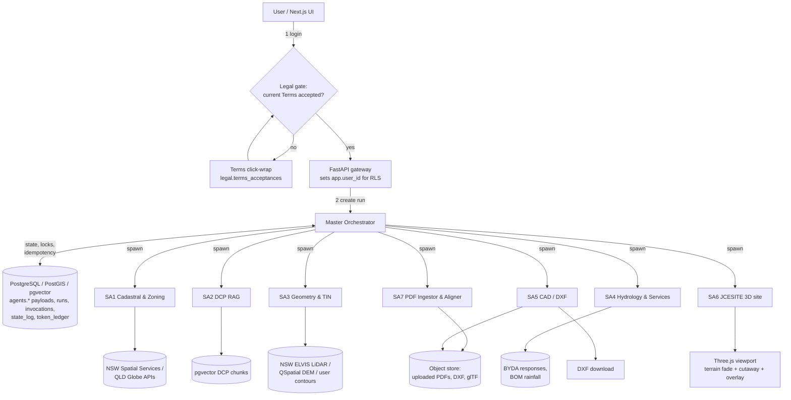
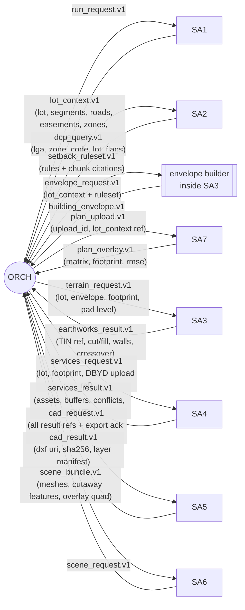

# Phase 1: Multi-Agent Orchestration Topology

Autonomous Cadastral & Civil Site Planning Platform (NSW and QLD)

Status: Phase 1 design, awaiting approval. No application code exists yet.

> **Deferred directive (user, Phase 1):** the frontend should emulate the look of https://planningai.com.au/. This is recorded for **Phase 4 only**. Nothing has been fetched, copied or built from that site. In Phase 4 we replicate layout, spacing, typography feel and colour mood, and use our own name, logo, copy and assets. We will not copy their branding or text.

---

## 1. Design principles

1. **Deterministic first, LLM only where judgement is needed.** Sub-Agents 1, 3, 4, 5 and 6 are pure code services (no model call). An LLM is used only in Sub-Agent 2 (reading DCP text and tables) and Sub-Agent 7 (reading title blocks, scale text, and classifying which vectors are the slab). This is the main token saving. It also makes geometry reproducible and auditable.
2. **Pass references, not bodies.** Agents exchange `payload_id` + `sha256` rows from `agents.payloads`. A large payload (a TIN, a contour set, a DXF) never enters an LLM context. A model sees only the small structured slice it needs.
3. **Stateless sub-agents.** Each invocation receives one input payload and returns one output payload. State lives only in Postgres (`agents.*`). Any invocation can be retried or replayed.
4. **Idempotency cache.** `idempotency_key = sha256(agent ‖ input_payload_sha256 ‖ agent_version)`. If a succeeded invocation has the same key, the orchestrator returns its output without running anything (`cache_hit = true`).
5. **Prompt caching.** The stable prefix of each LLM agent (system prompt, tool schemas, jurisdiction rule pack) is placed first and marked cacheable. Per-lot data goes last. Prefixes are tracked in `agents.prompt_cache_registry`. Cache read, cache write and fresh tokens are metered separately in `agents.token_ledger`.
6. **Legal gate before anything runs.** The orchestrator refuses to create a run unless `legal.has_accepted_current_terms(user)` is true. Export steps (SA5, SA6 public share) additionally require `legal.export_gate_missing(project, user)` to be empty.
7. **Every number carries provenance and a status.** Outputs start as `unverified`. Nothing is presented as certified.

## 2. Agent roster

| Code | Name | Type | Reads | Writes | LLM? |
|---|---|---|---|---|---|
| ORCH | Master Orchestrator | Controller | `agents.*`, `legal.*` | `agents.runs`, `state_log`, `token_ledger` | Light (planning/routing only; can be rules-based) |
| SA1 | Cadastral & Zoning Ingestor | Service | NSW Spatial Services and QLD Globe / Queensland Spatial Catalogue (ArcGIS REST) | `cadastre.*`, `planning.zones`, `lot_zoning`, `lot_overlays` | No |
| SA2 | DCP RAG Digestor | LLM + vector | `planning.dcp_chunks` (pgvector + tsvector hybrid) | `planning.setback_rules`, `building_envelopes` | Yes |
| SA3 | Geometry & TIN Engine | Service | contours, lot, envelope, overlay footprint | `terrain.*` | No |
| SA4 | Hydrology & Services Mapper | Service | DBYD PDFs, BOM rainfall, footprint | `utilities.*` | No (CV for DBYD raster) |
| SA5 | CAD & Annotation Pipeline | Service | all geometry + `annotations.*` | `annotations.*`, DXF in object storage | No |
| SA6 | JCESITE 3D site scene | Service | TIN, utilities, overlay | glTF/JSON mesh bundle | No |
| SA7 | Architectural PDF Ingestor & Spatial Aligner | CV + LLM | uploaded PDF, lot, boundary segments | `plans.*` | Yes (title block, scale, slab classification) |

## 3. System topology



## 4. Run DAG and JSON payload flow

The orchestrator builds this DAG per run. An edge label is the payload schema passed by reference.



Dependency order (parallel where possible):

```
Stage A (parallel):  SA1                      SA7 (needs lot_context for site-side control points,
                                              so SA7 starts after SA1 finishes; PDF page
                                              rasterise/extract work can pre-run in parallel)
Stage B (parallel):  SA2 (needs zone from SA1)       SA4 DBYD parse (needs lot work-area from SA1)
Stage C:             Envelope builder (SA1 + SA2) -> compare with SA7 footprint
Stage D:             SA3 (needs envelope, footprint, contours)
Stage E:             SA4 conflict + RWT (needs footprint, SA3 pad/walls)
Stage F (parallel):  SA5 DXF          SA6 3D scene   (both blocked by export ack gate)
```

### 4.1 Standard message envelope

Every orchestrator-to-agent and agent-to-orchestrator message uses this envelope. The `body` is never inlined for payloads over 8 KB.

```json
{
  "envelope_version": 1,
  "run_id": "6f1d3c1a-8d7a-4f70-9a53-1f6f0b2a7e11",
  "invocation_id": "0b8c2f1d-5b3d-4a3e-8f55-71b7f60b2c21",
  "from": "ORCH",
  "to": "SA7_PDF_ALIGN",
  "schema": "plan_upload.v1",
  "idempotency_key": "9f2c...e1",
  "terms_version_id": "c1f9...04",
  "token_budget": 12000,
  "payload_ref": { "payload_id": "a4d7...91", "sha256": "7be1...c3", "byte_size": 2381 },
  "deadline_ms": 120000
}
```

### 4.2 Example payloads

`lot_context.v1` (SA1 output, abbreviated to the fields downstream agents use):

```json
{
  "lot": {
    "lot_id": "2d1f...",
    "jurisdiction": "NSW",
    "lotplan": "12//DP345678",
    "lga_name": "Hornsby",
    "mga_srid": 7856,
    "area_m2_calculated": 612.418,
    "area_m2_registered": 612.0
  },
  "segments": [
    { "seq": 1, "bearing_deg": 87.24167, "bearing_dms": "87°14'30\"", "distance_m": 15.240,
      "adjoins": "road", "is_front": true }
  ],
  "zoning": { "zone_code": "R2", "instrument": "Hornsby LEP 2013", "dominant": true },
  "overlays": [ { "overlay_type": "bushfire", "attribute_json": { "category": "Vegetation Category 2" } } ],
  "source_snapshot_ids": ["f3a1..."]
}
```

`plan_overlay.v1` (SA7 output):

```json
{
  "overlay_id": "81ce...",
  "scale_denominator_used": 100,
  "scale_source": "title_block_text",
  "metres_per_point": 0.0352777778,
  "rotation_rad": 0.0412,
  "matrix_3x3": [0.035248, -0.001453, 334512.118,
                 0.001453,  0.035248, 6263901.442,
                 0, 0, 1],
  "control_point_count": 4,
  "rmse_m": 0.062,
  "max_residual_m": 0.094,
  "footprint_area_m2": 238.77,
  "inside_envelope": false,
  "envelope_encroachment_m2": 1.84,
  "status": "unverified"
}
```

## 5. Token routing

| Step | Model call? | What goes into context | Typical size | Cache behaviour |
|---|---|---|---|---|
| ORCH plan | Optional (a rules table covers the standard DAG) | run request + agent capability list | under 1 k | Prefix cached |
| SA1 | none | none | 0 | n/a |
| SA2 retrieve | none (SQL hybrid search: vector top-40 + tsvector, rerank to 8) | none | 0 | n/a |
| SA2 extract | yes | prefix: system + rule JSON schema + NSW/QLD terminology pack (cached). Suffix: 8 chunks (about 3 k tokens) + lot flags | about 4 k fresh, about 3 k cache read | prefix cached, 5 min TTL |
| SA3, SA4, SA5, SA6 | none | none | 0 | idempotency cache |
| SA7 title-block read | yes | one cropped raster of the title block plus text spans | about 1.5 k | prefix cached |
| SA7 slab classification | yes, only when geometric heuristics are ambiguous (confidence under 0.85) | top-N candidate polygons as compact JSON (id, area, bbox, stroke width) | under 2 k | prefix cached |

Controls:
- `agents.runs.token_budget` is a hard cap. The orchestrator stops an LLM agent when `tokens_used` reaches it and marks the run `waiting_user`, with the partial result stored.
- A re-run after a user edit (for example a moved lot corner) invalidates only the downstream payloads whose input hash changed. The rest return as cache hits.
- Per-lot LLM spend is expected to be dominated by SA2 and SA7, a few thousand tokens each. This is a design estimate to be measured in Phase 2.

## 6. PDF upload and matrix-alignment pipeline (SA7)

```mermaid
sequenceDiagram
    autonumber
    participant UI as Next.js upload
    participant API as FastAPI
    participant OBJ as Object store
    participant ORCH as Orchestrator
    participant SA7 as SA7 Aligner
    participant PG as PostGIS

    UI->>API: POST /plans (PDF, rights warranty ticked)
    API->>API: Size/type checks, sha256, MIME sniff, no JS/embedded files, page count
    API->>OBJ: store original (immutable)
    API->>PG: INSERT plans.plan_uploads (status=uploaded)
    API->>ORCH: plan_upload.v1
    ORCH->>SA7: invoke (needs lot_context.v1)
    SA7->>SA7: 1. Classify page: vector / raster / hybrid
    SA7->>SA7: 2. Vector: pdfplumber/pypdf extract lines, rects, curves, text spans (PDF points)
    SA7->>SA7: 2b. Raster: render 300 dpi, deskew, OpenCV edge + Hough + contour extraction
    SA7->>SA7: 3. Read scale: title-block text ("1:100 @ A1"), then scale-bar length, then dimension strings
    SA7->>SA7: 4. Cross-check scale: measured dimension (pts x metres/pt) vs dimension text
    SA7->>SA7: 5. Candidate slab polygons: closed, largest bold, near garage/porch labels
    SA7->>PG: INSERT plans.plan_vector_entities (paper space, SRID 0)
    SA7->>SA7: 6. Select control points: site plan boundary corners <-> lot corners
    SA7->>SA7: 7. Solve similarity transform (Umeyama), reject outliers
    SA7->>PG: INSERT plans.alignment_control_points, plans.plan_overlays (matrix, rmse)
    SA7->>PG: footprint_mga = ST_Affine(slab, a,b,d,e,xoff,yoff); envelope test
    SA7-->>ORCH: plan_overlay.v1 (status unverified)
    ORCH-->>UI: overlay + residuals; request scale confirmation if confidence under threshold
    UI->>API: user confirms/edits scale and control points
    API->>ORCH: re-run SA7 solve only (cache hit on extraction)
```

### 6.1 Scale to metres

PDF user space is points: 1 pt = 25.4 / 72 mm = 0.352777… mm on paper.

```
metres_per_point  s  =  (25.4 / 72) / 1000  ×  N          where N = scale denominator
```

Example: 1:100 gives s = 0.0352778 m per point (a 100 mm paper line is 10 m on the ground). The page size in points is cross-checked against the stated paper size (A1 = 1683.78 × 2383.94 pt). If the PDF was printed "fit to page", the stated scale is wrong, so SA7 requires the scale-bar measurement and a dimension string to agree within 1 percent. Otherwise `scale_confidence` drops below the threshold and the user must confirm.

### 6.2 Transform model

The solver fits a 2D similarity transform from paper points to MGA metres:

```
[X]   [ s·cosθ   -s·sinθ ] [x]   [xoff]
[Y] = [ s·sinθ    s·cosθ ] [y] + [yoff]
```

Stored as `a = s·cosθ, b = −s·sinθ, d = s·sinθ, e = s·cosθ` and the 3×3 homogeneous matrix `[a b xoff; d e yoff; 0 0 1]` for the WebGL layer. The same six numbers feed `ST_Affine(geom, a, b, d, e, xoff, yoff)`.

Because the drawing scale N fixes `s` independently of the control points, the solver offers two modes:
1. **Scale-locked** (default): `s` fixed from N; solve θ and translation only. Robust with 2 control points.
2. **Scale-free**: Umeyama estimates `s` too. If the fitted `s` differs from the stated one by more than 1.5 percent the system flags the drawing as unreliable (possible non-uniform printing or wrong scale).

Umeyama closed form (centroids μp, μq; covariance Σ = (1/n) Σ wᵢ (qᵢ−μq)(pᵢ−μp)ᵀ; SVD Σ = UDVᵀ; S = diag(1, det(UVᵀ))):
```
R = U S Vᵀ        s = tr(D S) / σp²        t = μq − s R μp
```
If `det(R) < 0` the drawing is mirrored. SA7 applies the correction (`reflection_applied = true`) and tells the user, because a mirrored architect plan is a classic error.

RANSAC rejects control-point pairs whose residual exceeds `max(3 × RMSE, 0.15 m)`. `rmse_m` and `max_residual_m` are stored on the overlay. Acceptance thresholds (initial, tunable): RMSE ≤ 0.10 m auto-accept as "unverified"; 0.10 to 0.30 m require user confirmation; over 0.30 m refuse and request manual control points.

### 6.3 Fallbacks

| Situation | Behaviour |
|---|---|
| No site plan on the PDF, only floor plans | Request the user to click two lot corners and the matching slab corners (`user_picked` control points) |
| Raster scan, rotated page | Deskew from dominant Hough angle, derive `rotation_deg`, record `paper_to_pixel` |
| Multiple candidate slabs | Return ranked list; user picks |
| Scale unreadable | Block alignment (`status = failed`, `failure_reason`), ask for user-entered scale |
| Layered vector PDF (optional content groups) | Use layer names as a classification signal |

## 7. Failure, retry and gate semantics

| Event | Orchestrator action |
|---|---|
| Sub-agent timeout / 5xx | Retry up to 2 times with backoff; new `attempt` row; `state_log: retry` |
| External API down (NSW/QLD) | Serve last `cadastre.source_snapshots` marked stale and tell the user the data date |
| Validation failure (invalid geometry, SRID mismatch) | Fail fast; never "repair" silently. Record `error_code` |
| Terms version changed mid-run | Finish read-only steps, block exports until re-acceptance |
| Export requested with missing acknowledgements | `blocked_by_gate`; UI shows exactly which `legal.acknowledgement_kind` values are missing |
| Token budget exhausted | `waiting_user` with partial results |

## 8. Phase map

| Phase | Delivers |
|---|---|
| 1 (this) | Topology, schema, Terms |
| 2 | Orchestrator patterns, SA7, SA5 |
| 3 | SA1, SA2, SA3, SA4 |
| 4 | Next.js frontend, Terms gate page, WebGL canvas, cutaway, **visual style emulating planningai.com.au (deferred, own branding and assets)** |

## 9. Open questions for you

1. **Data licences:** confirm you accept CC BY 4.0 attribution for NSW Spatial Services and Queensland Government data, and that LiDAR/DEM from ELVIS/QSpatial is acceptable for cut/fill.
2. **BYDA:** the platform ingests BYDA response PDFs the user uploads; it does not place enquiries. Confirm that scope.
3. **Embeddings model/dimension:** the schema uses `vector(1536)`. Change now if you prefer another model.
4. **Hosting region:** Australian region assumed (data residency, Privacy Act).
5. **Legal review:** the Terms are a draft for an Australian-qualified solicitor to finalise (see header of the Terms).
